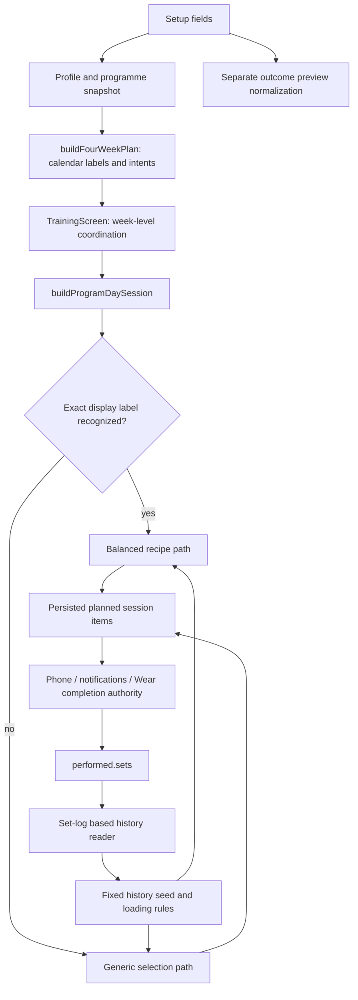
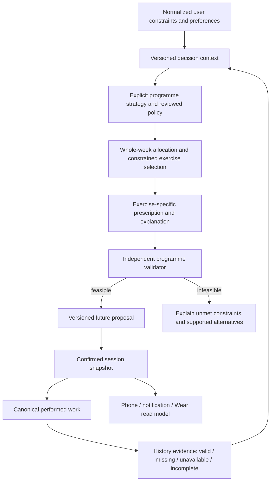

# Reclaim training intelligence and EIF: Phase 1 decision report

**Status: investigation and recommendation only; implementation scope NONE.** Prepared 12–13 October 2026. Operator approval is required before corrections. This audit supersedes the old resume mandate for this task; it does not restart the historical programme.

## 1. Executive assessment

Reclaim has useful training components but does not yet provide a coherent, verifiable training decision system. The main problem is not simply too much exercise repetition or a particular set count. Different paths interpret the same person's inputs differently, important decisions lose meaning between components, and programme-level acceptance has not reliably checked the result the person receives.

The strongest reproduced examples are concrete:

- A five-day plan with floor-only equipment produces five empty strength sessions in the current named-day path. A dumbbell-only pull day can contain curls, rear-delt work and shrugs without a primary back exercise.
- Adding a trailing space to a day label changes the prescription algorithm and exercise selection. Presentation text is acting as a strategy identifier.
- An effort rule recommends reducing a 100 kg set to 95 kg, but the view's conversion stores a zero adjustment and the next-set reader still returns 100 kg. The explanation and effective prescription disagree.
- Two- and three-day hybrid schedules contain no runs in the inspected planner output.
- A progression decision can recommend 82.5 kg after successful work, while the loading function still returns 80 kg because an old baseline ceiling wins.

These are high-priority correctness and product-trust defects. Their actual incidence in user accounts and any health consequences were not measured. No current Android journey or live database record was used to reproduce them. They should not be presented as proof of injury or universal scientific invalidity.

The science has a separate problem: research findings, product preferences, counting conventions and numerical heuristics have been blended into apparently precise policies without a consistently reconciled rule register. Repeating an exercise or a weekly structure is not inherently wrong. Research does not uniquely determine Reclaim's goal-percentage arithmetic, universal muscle allocations, load-transfer rules or recovery decisions. Those choices need explicit justification and approval rather than another round of unexplained constants.

EIF contributed real strengths: durable evidence, revision-checked ledger operations and recorded gate rejections, useful narrow tests, documented limits and explicit refusal to invent some missing rules. However, administrative completion became a stronger signal than demonstrated training quality. Training items whose own evidence said that important acceptance remained unmet were later completed. Broad journey selection was handled with blanket non-applicability records. Specialist and independent-review provenance was too weak to establish that the intended challenge loop operated.

**Recommended direction:** a deterministic, versioned programme pipeline with explicit curated programme families, common eligibility and prescription contracts, a separate whole-programme validator, and evidence-aware future progression. Retain the canonical calendar/session/completion entry points and frozen started-session truth. A solver is a credible alternative if approved requirements exceed curated families; it is not automatically more scientific. Shared EIF changes require separate authority.

## 2. Scope, baseline and evidence quality

Reclaim: `C:/Reclaim`, branch `fix/training-confident-ux`, HEAD `a9163835e7e649c101320853d85fd8df1e5b883e`. Remote and root commit match the project manifest. Four pre-existing tracked modifications were preserved: Supabase CLI cache, run-route migration, insight audit and Play outstanding-check document. Numerous existing untracked artifacts were also preserved; see [initial status](evidence/initial-status.txt). No source, live data, historical session, ledger, hook configuration or shared framework was changed by this audit.

Shared EIF: read-only GitHub inspection pinned to `f03832d7b95f3fc293b02294e5215f1a4b6453ee`. [Upstream manifest](framework/upstream-manifest.json) identifies fetched files and hashes. Reclaim's installed runtime bytes were deliberately not inspected, per project restrictions. Upstream mechanism evidence must not be described as proof of installed-byte equivalence. No `main` branch checkout or mutation occurred.

Evidence classes used here:

- **Reproduced:** unchanged source functions executed in isolated audit probes. They demonstrate the stated contract behavior, not mounted UI/DB/native behavior.
- **Source-confirmed:** static producer/consumer or persisted-record evidence; runtime reachability and incidence are qualified where necessary.
- **Historical:** ledger events and contemporaneous artifacts establish what was recorded, not inaccessible operator conversations or every past specialist's actual reasoning.
- **Inference/proposal:** causal interpretation or desired behavior, explicitly separated from observation.

Existing focused tests passed: [22 tests in three files](evidence/focused-vitest.txt) and [30 tests in four files](training/targeted-tests.txt). The selections overlap; these are not 52 unique tests. The full suite, native build and full repository harness were not rerun because no implementation was made. Initial test execution hit sandbox `spawn EPERM`; the authorized rerun produced the saved passing result. Passing selected tests is counterevidence against a generally broken test runner, not evidence of programme fitness.

Visual status: **UNABLE_TO_RENDER current Android UI**. `adb devices` started the daemon and returned no devices. No emulator was cold-booted, app reinstalled, account changed or session started. Historical screenshots and narrative observations cannot certify current pixels. No proposed visual redesign or production chrome is included; an architecture/data-flow proposal is more appropriate to this audit than a cosmetic mockup.

Detailed evidence and specialist reasoning: [training investigation](training/REPORT.md), [product/architecture critique](product/HANDOFF.md), [EIF process investigation](framework/REPORT.md), [independent cross-check](product/verification-deltas.md), [consultation record](consultation/ADJUDICATION.md). Some supplementary records were finalized after this report's first draft; the final evidence index records their state.

Three separate specialist agents actually performed analysis; the product agent re-executed the other streams' probes and the framework agent [reviewed this consolidation](framework/final-review.md). These are same-model executions with inherited context, not blind external or clinical reviews. External Claude consultation was attempted: initial network refusal, then an authorized retry returned HTTP429 weekly usage limit with zero inference tokens. **No substantive external-model critique occurred.** The saved receipt makes this distinction explicit. GOV-008 permits limited R2 self-verification when another session is unavailable; historical self-review is therefore not automatically a framework violation. The issue is whether the required evidence and limitations survive acceptance.

## 3. Current decision flow and why local fixes have not been enough

The wrapper and single calendar writer are worthwhile boundaries, but do not establish one prescription policy. Weekly selection context lives in a screen, the engine has two materially different selection routes, previews omit fields, and progression reads a different representation from completion authority. A correction in one function can be bypassed elsewhere. Existing tests frequently inject ideal inputs directly or call generic labels instead of the real planner-produced named days.

## 4. Major findings and root causes

Severity is product/engineering priority, not a clinical risk score. All proposed remediation remains subject to approval. Detailed files contain narrower line references and test-intent classifications.

| ID | Observed / expected behavior | Root cause, evidence and confidence | Responsible layers; how it escaped |
|---|---|---|---|
| R1 High | Labels change strategy; supported-looking equipment inputs yield empty or incomplete sessions. Expected stable strategy identity and explicit infeasibility/coverage validation. | Reproduced in [probe output](training/probe-results.json); `balancedHypertrophy.ts:151–170,246–254`, `engine/index.ts:1799–1822`. A fixed candidate list returns success even when slots vanish. | Implementation, architecture specification, verification. Golden tests often use `FB`/`Legs` or generic `buildSession`; balanced tests cover a narrow gym fixture. A wrapper audit cannot detect divergent semantics. |
| R2 High | Disliked exercises remain selectable on the balanced route; time/experience/preference treatment differs across paths. Expected all strategies to honor the same hard constraints and explicitly ranked preferences. | Dislike bypass reproduced. Balanced path has its own equipment/injury filters, but omits generic preferences and uses its own time cap. Experience does affect loading; do not say it is entirely ignored. `balancedHypertrophy.ts:175–254,301–316`. | Implementation and verification; duplicated eligibility/prescription contracts. Existing path-specific tests establish local behavior, not invariant parity. A baseline allowing a missing rack is a product rule needing challenge, not proof the rack exists. |
| R3 High | Load-reduction explanation survives while numeric reduction disappears. Expected agreement between approved adjustment, stored representation and all guidance. | Reproduced 100→95 recommendation /100 effective next set in [autoregulation probe](product/autoregulation-probe-result.json). `runtime/autoregulation.ts:141–182`, `TrainingSessionView.tsx:769–786`, `sessionDerivedState.ts:23–48`. Multiplier/absolute weight becomes absent delta defaulted to zero. | Implementation and verification. Producer tests passed; permissive optional DTO fields and missing producer-to-consumer integration test hid a no-op. No new reduction percentage is endorsed by this finding. |
| R4 High | Settings offers fatigue-based easing without a production-assigned fatigue input; balanced route bypasses the adaptive option. Expected a working, explainable capability or explicit unavailable state. | Source-confirmed: `SettingsScreen.tsx:1180–1196`, `adaptiveLoadBias.ts:21–23`, `engine/index.ts:1807–1850`; production search found no assignment of required fatigue proxy. Intra-session RPE rules do exist, so this is not “no adaptation anywhere.” | Implementation, specification, verification. Unit tests inject synthetic fatigue; end-to-end signal sourcing was not established. |
| R5 High | Preview and confirmation use different input sets; skill preference is saved to profile but omitted from programme snapshot. Expected identical normalized decision context for an identified preview/confirmation. | Source-confirmed: `TrainingSetupScreen.tsx:383–395,413–480`; `OutcomePreviewPanel.tsx:9–42`; `preview/index.ts:84–150`. Preview assumes five baseline reps and omits experience. | Implementation and verification. Preview parity test reconstructs the same simplified assumptions, creating circular evidence. Earlier audit had already noted preference propagation problems. |
| R6 High | Swap copies existing weight/reps to a different exercise; “programme” scope updates the current session item. Expected eligible replacement, exercise-specific calibration, truthful scope and preserved completed history. | Source-confirmed: `TrainingSessionView.tsx:985–1085`; balanced alternatives are raw candidate IDs at `balancedHypertrophy.ts:310–311`. Actual completed-history corruption not reproduced. | Implementation, specification, verification. Swap was treated as identity replacement rather than a prescription decision; RA-020 had identified this class of gap. Completion parity tests do not test load semantics or future programme scope. |
| R7 High | History is limited to fixed exercise IDs and errors become empty history; progression recommendation can be clamped by old baseline. Expected explicit evidence availability and coherent calibration/progression precedence. | Fixed31-ID seed and source readers documented in PA-07; `api.ts:2642–2720` reads set logs after item selection. Probe reproduces82.5 recommendation/80 prescription, improving reps counted as holds, and progression decision from one logged set without planned completeness input. | Specification, implementation, verification. Injected-history tests bypass acquisition; seed test checks only minimum length and squat inclusion. A one-set decision is not always wrong; the missing completeness contract prevents distinguishing intentional from partial work. |
| R8 High | Muscle ownership, movement pattern, display totals and stimulus are conflated. Expected separate definitions and transparent accounting. | Current October9 amendment describes one owner per exercise; catalogue bench still has chest/shoulder/triceps primaries, and row has three primaries in the Back bucket. Formatter adds each tag, so one row set adds three Back counts. Source-confirmed in `weeklyVolumeSummary.ts:35–62`, `muscleTaxonomy.ts` and catalogue; detailed analysis in training report. | Specification, domain briefing, implementation, verification. Display/tag tests do not validate semantic consistency. An ownership policy does not change anatomical involvement. Exact secondary-muscle fractions are not established by this audit. |
| R9 High | Hybrid2/3-day output contains no running; repeated calendar weeks lack an accepted longitudinal decision contract. Expected mode feasibility and explicit hold/progress/reduce/missed-session/block-end behavior. | Hybrid outputs reproduced; planner source and `fourWeekProgression.test.ts:64–91` deliberately preserve unchanged week prescriptions. | Specification, implementation, verification. Tests can pin a chosen split without asking whether “hybrid” is delivered. Identical weeks are not inherently scientifically wrong; closure claimed more than the defined policy proved. |
| R10 High | Weekly previews regenerate from current history/code rather than projecting started/completed snapshots; fallback consumers omit week coordination. Expected explicit distinction between historical, frozen planned and provisional future work. | Architectural risk confirmed in `TrainingScreen.tsx:471–534,1010–1019`; `WearablesProjectionService.ts:60–68` regenerates duration only. Current user-visible mismatch not reproduced. | Architecture specification, implementation, verification. Snapshot-freeze tests protect storage locally, not the mixed-week read model. Do not allege wrong Wear kilograms from a duration-only projection. |
| R11 High | Product addresses recovery contexts but decision inputs cannot establish broad injury/illness-specific training suitability. Expected explicitly supported population and boundaries. | Product mission versus `TrainingProfileSnapshot` and setup; inference from scope/input mismatch, not observed harm. Research cited in routine/running docs requires population/outcome applicability review. | Specification, domain briefing, verification. Technical personalization was treated as a proxy for appropriate personalization. Goal-weight interpolation is a product heuristic, not validated physiology. |
| R12 High | Zero represents both bodyweight and uncalibrated external load; follow-up compound prescription can use isolation rep targets while progression uses accessory ranges; duration is a per-slot estimate independent of actual sets/rest. Expected typed load states, consistent qualification targets and validated feasibility. | Source-confirmed in training T05/T09: `balancedHypertrophy.ts:221,257–262`, `progression.ts:289`, engine loading ranges. Only first compound receives generated warm-up rows. Runtime incidence and individual suitability unmeasured. | Domain specification, implementation, verification. Table-output and cap tests do not test unit semantics, prescription/progression composition or timed feasibility. No new warm-up or population-load constants are authorized. |

Important counterevidence: equipment/injury checks do exist in the balanced path; repetition may serve skill practice; experience changes loads; canonical completion and frozen snapshots are genuine protections; refusal to invent a four-week wave was sound. These facts narrow the findings rather than remove the contract defects.

### Process findings

| ID | Observed / expected | Evidence and confidence | Cause and escape |
|---|---|---|---|
| E1 High | N-0011/23/24 completed while contemporaneous evidence explicitly excluded weekly muscle bands or week-wise load/RIR requirements. Expected criterion satisfaction or explicit accepted revision/waiver. | Charter and baseline records; `PROGRAM_LOG` seq339/364/366. Confirmed recorded mismatch. Original operator waiver conversations unavailable. | Specification + orchestration + verification/integration. Missing policy was correctly reported, but later generic closure prose substituted for resolved acceptance. Cannot conclude approval never occurred. |
| E2 High | Reclaim journey YAML uses `nodes:`; inspected upstream selector ignores it, selects broadly, and NA accepts nonempty rationale. Expected supported selectors and specific applicability. | [reproduction](framework/reproduction.json), upstream `journeys.py`, October5 closure rationale. Confirmed upstream pure-function mechanism and local mismatch; installed source identity unknown. | Integration defect plus framework schema/waiver weakness. Noisy over-selection led to blanket NA, including relevant training items. Full public-event admission was not tested. |
| E3 High | Specialist execution and independence cannot be reconstructed from ledger. Expected real executor, brief, input, output and disposition receipts. |524 events;56 journey verification events (52 NA/4 pass), no independence fields. Wrapper hardcodes actor `gov-001`; several reports honestly identify self-review. | Orchestration + verification/integration; shared gate does not enforce normative independence metadata. One actor value does not prove one historical model/person; missing receipts do not prove no reviews anywhere. |
| E4 Medium | Runtime capability remains unverified, hooks intentionally off, active session is Codex. Expected current-mode measured claims. | `.eif/RUNTIME_CAPABILITIES.md`, instructions and mode. Confirmed assurance limitation. | Integration/operations, not evidence of faulty hook code. Platform sandbox remains separate; enabling EIF hooks would not validate training science. |
| E5 High | Wrapper completion auto-emits acceptance; render wait checks directory contents and records a note; commit argument does not prove push/evidence binding. Expected truthful approval/commit/criterion semantics. | `scripts/eif_node.py`; public gate failures documented in N0053 and LEDGER_PENDING. Confirmed code semantics. | Integration plus shared public-contract weaknesses. Convenience commands rely on caller discipline for stronger English claims; not proof of unauthorized historical approval. |

## 5. Scientific and product rules requiring reconciliation

The authoritative local intent documents remain [ROUTINE_AUDIT](../../../docs/training/ROUTINE_AUDIT.md) and [RUNNING_DESIGN](../../../docs/training/RUNNING_DESIGN.md). They are evidence of accepted/history-dependent intent, not proof of correctness. Their dated sections contain superseded assumptions; September baseline numbers must not be presented as current outputs.

The training specialist's evidence review distinguishes research support for resistance training/progression and contextual dose/frequency effects from Reclaim-specific translations. In particular:

- A population average, review category or ranked intervention is not a unique personalized optimum, universal cap or mandatory schedule.
- Direct and indirect muscle work need a declared counting convention. Assigning one display owner does not establish that other muscles receive no stimulus. Fractional accounting is an approximation requiring an approved model, not a new physiological truth.
- Exercise variation and repeated practice both have legitimate uses. Evaluate programme purpose, exposure and constraints rather than optimizing novelty alone.
- Volume/frequency evidence does not automatically validate arithmetic interpolation of unrelated goal prescriptions or transporting ratios between exercises/implements.
- Returning after interruption, missing history, effort uncertainty, unavailable equipment and infeasible schedules are domain states, not reasons to silently fall back to plausible-looking output.

Before new rules are adopted, each must record: supported population; intended outcome; units; evidence source and strength; extrapolation; product rationale; contraindication/constraint meaning; uncertainty; decision owner; acceptance scenarios; review trigger. Existing numerical constants are observations, not approved replacements in this report. No new training constant has been introduced.

Two specific scientific-policy contradictions need adjudication. RUNNING_DESIGN RD-001 requires completed, comfortable prior work before increasing minutes on a new build; RD-006 instead establishes a calendar-driven week-three step, translating moderate/vigorous population-guideline quantities into a ramp. This is confirmed documentary conflict, not an approved replacement progression. ROUTINE_AUDIT also extends exercise-order advice into one-compound-per-pattern policy and uses a group squat ratio for a different lift. The cited research does not itself establish those unique product rules; see training T08/T09 and its scientific review for scope and retrieval limits.

Current evidence supports this distinction: the [2026 ACSM overview](https://pubmed.ncbi.nlm.nih.gov/41843416/) concerns healthy adults and does not find consistent added benefit from periodization across outcomes. The [Pelland dose-response analysis](https://doi.org/10.1007/s40279-025-02344-w) evaluates direct/indirect set accounting as a model, not an individual muscle-response measurement. Neither source selects Reclaim's final policy. The training appendix also assesses talk-test and concurrent-training evidence. Qualified domain acceptance remains outstanding.

## 6. Recommended system and alternatives

Recommended logical flow:

“Independent validator” means separately specified acceptance logic; it need not be another service or an AI agent. It must not calculate the expected result by calling the generator under test.

| Option | Correctness/personalisation | Explainability/adaptability | Recommendation |
|---|---|---|---|
| Curated programme families, constrained selection, shared prescription and independent validator | Bounded, reviewable rules; explicit unsupported cases; enough flexibility must be proven against approved profiles | Clear strategy/slot purposes; extensible through versioned policy | Preferred first target, conditional on scenario coverage, not smaller code diff |
| Whole-week constraint optimization | Can resolve interacting schedules, coverage and preferences; requires credible objectives and stimulus model | Explains constraints but trade-off weights can be opaque; supports broader flexibility | Compare in a bounded prototype if curated families cannot meet accepted constraints; do not select merely for sophistication |
| Patch both existing paths and keep label routing | May repair individual symptoms | Continues hidden semantics, propagation gaps and difficult replay | Not an acceptable final architecture |

A generative model as prescribing authority has no demonstrated necessity here. If later proposed, it needs a separate safety/evaluation case; it does not solve an undefined product objective.

### Components and data contracts

**Retain:** `buildFourWeekPlan` as the only calendar writer; `buildProgramDaySession` public materialization route; `sessionWorkAuthority.ts`/`applySetCompletion()` and `performed.sets`; frozen started/guided sessions; notification intent reconciler and single native FGS; stable exercise IDs; useful deterministic functions and invariant tests.

**Improve:** profile normalization, complete preference propagation, equipment and forbidden-movement validation, approved muscle taxonomy and loading semantics, evidence availability/freshness, progression completeness rules, explanation provenance, session time estimation and mixed historical/future weekly read model.

**Replace:** presentation-label strategy dispatch, duplicated per-surface planning context, fixed seed IDs as the history capability boundary, incompatible adjustment fields, raw candidate alternatives and copied prescriptions on replacement.

**Remove or hide only after approval:** ineffective controls and false programme-wide replacement scope if supported behavior cannot be delivered; obsolete paths after caller and compatibility verification. Do not delete an unused adaptation module until deciding the accepted capability.

Proposed logical records (not an approved schema migration): normalized profile revision; policy/strategy/catalogue versions; history-evidence status and referents; proposal input/output digest; slot purpose and eligible candidates; prescription units/loading modality and rationale; validator result with unmet constraints; immutable confirmed session reference; optional separately authorized adjustment event; performed evidence and next-decision reason. Determine what fits existing JSON snapshots before proposing database changes.

New builds may adopt approved policy versions. Started sessions and completed history retain their recorded truth. Future adaptation is explicit and versioned. Automatic intra-session overlays are a separate material decision; architecture approval alone does not authorize altering frozen sets.

## 7. EIF effectiveness and proposed improvements

Existing framework functionality already specifies product/domain challenge, architecture alternatives, independent verification, primary evidence, test-intent classification, critique-oriented Audit Mode and measured enforcement. These should be activated, not reinvented under new specialist names.

**Reclaim integration:** reconcile requirement/evidence/waiver state; correct journey selectors against supported schema; preserve unverified outcomes in completion views; test wrapper semantics; pin installed framework provenance; route training-domain and programme acceptance explicitly. Retain historical records, adding corrections rather than retroactive success claims.

**Agent briefing/orchestration:** appoint one integration writer while permitting separate read-only challengers; brief desired outcomes and constraints rather than only defect lists; require competing explanations and coverage of actual production routes; record real session/model identity where available, inputs and output hashes, disagreements and dispositions. Separate source validation, domain acceptance, runtime validation and release approval.

**Shared EIF, separate authority:** propose strict/versioned journey schema; selector diagnostics; specific non-applicability versus approved waiver; requirement-version and evidence/commit binding; typed public review/approval commands; meaningful independence provenance checks. A schema can check that a receipt exists, not certify the quality of its reasoning. Retain adversarial human/model review of semantic evidence and report unresolved limitations.

Do not require every specialist or a full ceremony for trivial changes. Route on material decision surfaces. Runtime-safety upgrades are a separately scoped assurance task; hooks stay off during this audit and are not a remedy for scientific correctness.

## 8. Concrete recurrence controls

| Findings | Control and location | Evidence required |
|---|---|---|
| R1–2 | App programme contract tests across real planner-produced days; metamorphic label test; common eligibility validator | Full inputs, strategy/version, selected/omitted slots, explicit infeasibility, constraint assertions; no empty strength success |
| R3–4 | Producer→persisted adjustment→reader integration and setting-to-signal capability test | Effective next weight/reps/skip agrees with approved decision and message; unavailable/stale inputs distinguished |
| R5 | Setup serializer/preview/confirmation equivalence tests | Identical normalized input digest; every exposed field traced to effect or intentional no-effect |
| R6 | Substitution contract tests and Android journey | Replacement eligibility/units/re-prescription; prior work identity unchanged; declared future scope actually persists |
| R7 | History adapter tests plus longitudinal simulations | Partial/skipped/unfinished/error/stale evidence; broad exercise coverage; accepted progression/calibration precedence and reasons |
| R8, R11 | Reviewed taxonomy and policy register; independent programme rubric | Anatomical versus display/stimulus meaning, source population/outcome, approximation labels, domain reviewer disposition |
| R9–10 | Whole-programme and mixed-week read-model tests | Hybrid contains supported modes or explicit infeasibility; past snapshots unchanged; future decisions replay; interruption/block-end scenarios |
| R12 | Typed loading states and final-prescription feasibility tests | Unknown/external/bodyweight/assisted loads remain distinct; progression compares actual prescribed target; duration derives from final work/rest assumptions and exposes uncertainty |
| E1, E5 | Reclaim criterion/evidence matrix and wrapper contract tests | Satisfied/waived/superseded/unverified per criterion, approver and residual gap; exact commit/evidence binding |
| E2 | EIF selector and waiver adversarial fixtures | Unsupported keys rejected; relevant training journeys remain required; unrelated journeys excluded; blanket NA cannot masquerade as execution |
| E3–4 | Review receipts and separately authorized capability measurement | Actual briefs/executors/results/deltas; independence limitations; exact-mode observed controls and invalidation triggers |

Representative acceptance must cover supported goals, novice/trained users, constrained/full equipment, selected-day patterns, running/strength/hybrid, explicit dislikes/forbidden movements, absent or improving history, missed sessions and incompatible load modalities. Expected results come from approved requirements and independent rubric, not snapshots alone. Scientific uncertainty must remain visible even when deterministic constraints pass.

## 9. Prioritised implementation proposal — not execution authority

| Package | Dependency / scope | Outcome and acceptance | Verification / risk |
|---|---|---|---|
| P0 Policy and acceptance reconciliation | Operator direction approval; Reclaim product/domain/orchestration | Supported population, rule register, resolution of old acceptance contradictions, scientific questions assigned; no competing active policies | Independent domain/product review; risk: choosing convenient constants instead of justified rules |
| P1 Decision and data contracts | P0; Reclaim architecture | Stable strategy identity, normalized inputs, history status, validation and frozen/future boundary | Architecture challenge plus replay scenarios; separately approve any migration |
| P2 Demonstrated contract defects | P0/P1 where semantics required | Correct adjustment transport, preview inputs, preference/eligibility, hybrid feasibility, substitution and progression precedence | Focused integration reproductions then full required harness; started-session/history invariants must hold |
| P3 Programme policy implementation | P0/P1; existing public entry points retained | Curated strategy implementation passes independent whole-programme rubric; explicit infeasibility | Compare optimizer only if scenario evidence warrants; risk: encoded policy may remain scientifically uncertain |
| P4 Longitudinal and Android verification | P2/P3; working AVD and approved fixture/account | Preview→persisted start→completion/skip→resume→next prescription→block-end consistency; phone/FGS/Wear guidance parity | Fresh verifier plus source/native evidence; no live-history changes without authority; physical watch checks queued if unavailable |
| P5 Reclaim EIF integration | Can begin after P0 direction; does not require shared EIF edits | Accurate criterion states, selector mappings, review receipts, tested wrapper | Negative tests for false closure/waiver; preserve historical ledger via canonical wrapper |
| S1 Shared EIF improvements | **Separate framework authorization**, then host compatibility plan | Versioned schema, typed public gates, waiver and provenance semantics | Isolated framework work, adversarial fixtures and Reclaim adapter compatibility; do not modify shared main |
| P6 Recovery closeout | P2–5 and required independent acceptance | Before/after evidence by finding, residual gaps, approved release state | Full relevant harness, independent verification and operator visual approval; no production deployment included |

Actual EIF work-item creation, leases and implementation decomposition occur only after direction approval. No historical node is reopened or completed by this report. Each later validated implementation node follows commit/push and evidence workflow. Source checks alone cannot close blocked runtime/domain acceptance.

## 10. Decisions requiring approval

1. **Product boundary and science adjudication.** Recommend a bounded nonclinical training capability for explicitly supported users, with qualified independent review before injury/illness-specific suitability claims. Approve a policy reconciliation step; this approves no new numerical training rules. Trade-off: narrower promise and explicit unsupported states versus unsupported apparent personalization.
2. **Architecture direction.** Recommend the deterministic versioned pipeline, curated constrained programme families and independent validator. Commission optimizer comparison only if accepted scenarios expose a material limitation. Trade-off: bounded reviewability versus broader optimization flexibility and model complexity.
3. **Frozen plans and adaptation.** Recommend preserving started/guided snapshots and history absolutely. Future proposals may adapt under approved policy. Treat automatic intra-session adjustment overlays as a separate explicitly approved policy; ineffective or misleading controls may instead be hidden after authorization. Trade-off: responsive guidance versus auditability and cross-device consistency.
4. **Recovery scope and acceptance.** Recommend approving P0/P1 specification/design work and the demonstrated correction programme conditional on its approved policies, with independent programme-quality and Android acceptance. Keep scientific rule choices that remain unresolved at a decision gate. Routine implementation details should remain delegated.
5. **Shared EIF authority.** Recommend approving Reclaim integration recovery separately from any shared-framework implementation. Shared changes should begin only on a named isolated branch after a separate grant, using the reproduced gate failures as acceptance. Trade-off: added coordination versus preventing a project-specific workaround becoming global policy.

**STOP: Phase 2 has not begun.** Findings and recommendations are submitted for operator and independent-reviewer direction. No approval is inferred from elapsed time, test success or this report.
