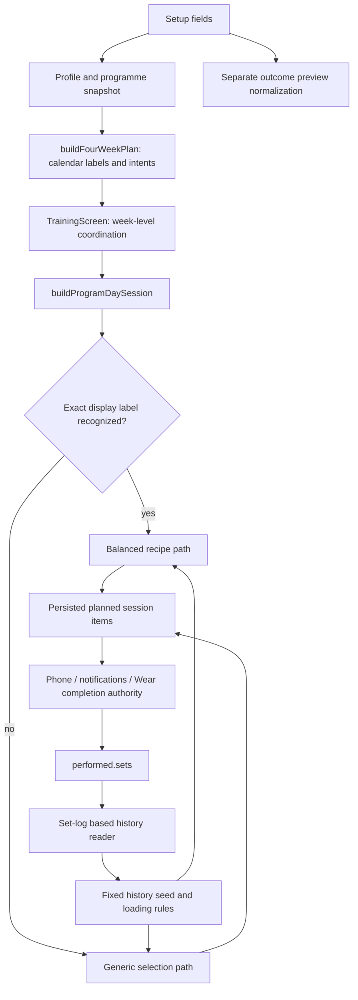
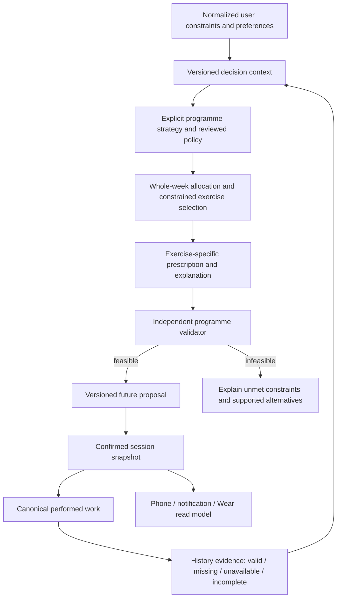

# Reclaim training intelligence and EIF: Phase 1 decision report

**Status: investigation and recommendation only; implementation scope NONE.** Prepared 12–13 October 2026. Operator approval is required before corrections. This audit supersedes the old resume mandate for this task; it does not restart the historical programme.

## 1. Executive assessment

Reclaim has useful training components but does not yet provide a coherent, verifiable training decision system. The main problem is not simply too much exercise repetition or a particular set count. Different paths interpret the same person's inputs differently, important decisions lose meaning between components, and programme-level acceptance has not reliably checked the result the person receives.

The strongest reproduced examples are concrete:

- A five-day plan with floor-only equipment produces five empty strength sessions in the current named-day path. A dumbbell-only pull day can contain curls, rear-delt work and shrugs without a primary back exercise.
- Adding a trailing space to a day label changes the prescription algorithm and exercise selection. Presentation text is acting as a strategy identifier.
- An effort rule recommends reducing a 100 kg set to 95 kg, but the view's conversion stores a zero adjustment and the next-set reader still returns 100 kg. The explanation and effective prescription disagree.
- Two- and three-day hybrid schedules contain no runs in the inspected planner output.
- A progression decision can recommend 82.5 kg after successful work, while the loading function still returns 80 kg because an old baseline ceiling wins.

These are high-priority correctness and product-trust defects. Their actual incidence in user accounts and any health consequences were not measured. No current Android journey or live database record was used to reproduce them. They should not be presented as proof of injury or universal scientific invalidity.

The science has a separate problem: research findings, product preferences, counting conventions and numerical heuristics have been blended into apparently precise policies without a consistently reconciled rule register. Repeating an exercise or a weekly structure is not inherently wrong. Research does not uniquely determine Reclaim's goal-percentage arithmetic, universal muscle allocations, load-transfer rules or recovery decisions. Those choices need explicit justification and approval rather than another round of unexplained constants.

EIF contributed real strengths: durable evidence, revision-checked ledger operations and recorded gate rejections, useful narrow tests, documented limits and explicit refusal to invent some missing rules. However, administrative completion became a stronger signal than demonstrated training quality. Training items whose own evidence said that important acceptance remained unmet were later completed. Broad journey selection was handled with blanket non-applicability records. Specialist and independent-review provenance was too weak to establish that the intended challenge loop operated.

**Recommended direction:** a deterministic, versioned programme pipeline with explicit curated programme families, common eligibility and prescription contracts, a separate whole-programme validator, and evidence-aware future progression. Retain the canonical calendar/session/completion entry points and frozen started-session truth. A solver is a credible alternative if approved requirements exceed curated families; it is not automatically more scientific. Shared EIF changes require separate authority.

## 2. Scope, baseline and evidence quality

Reclaim: `C:/Reclaim`, branch `fix/training-confident-ux`, HEAD `a9163835e7e649c101320853d85fd8df1e5b883e`. Remote and root commit match the project manifest. Four pre-existing tracked modifications were preserved: Supabase CLI cache, run-route migration, insight audit and Play outstanding-check document. Numerous existing untracked artifacts were also preserved; see [initial status](evidence/initial-status.txt). No source, live data, historical session, ledger, hook configuration or shared framework was changed by this audit.

Shared EIF: read-only GitHub inspection pinned to `f03832d7b95f3fc293b02294e5215f1a4b6453ee`. [Upstream manifest](framework/upstream-manifest.json) identifies fetched files and hashes. Reclaim's installed runtime bytes were deliberately not inspected, per project restrictions. Upstream mechanism evidence must not be described as proof of installed-byte equivalence. No `main` branch checkout or mutation occurred.

Evidence classes used here:

- **Reproduced:** unchanged source functions executed in isolated audit probes. They demonstrate the stated contract behavior, not mounted UI/DB/native behavior.
- **Source-confirmed:** static producer/consumer or persisted-record evidence; runtime reachability and incidence are qualified where necessary.
- **Historical:** ledger events and contemporaneous artifacts establish what was recorded, not inaccessible operator conversations or every past specialist's actual reasoning.
- **Inference/proposal:** causal interpretation or desired behavior, explicitly separated from observation.

Existing focused tests passed: [22 tests in three files](evidence/focused-vitest.txt) and [30 tests in four files](training/targeted-tests.txt). The selections overlap; these are not 52 unique tests. The full suite, native build and full repository harness were not rerun because no implementation was made. Initial test execution hit sandbox `spawn EPERM`; the authorized rerun produced the saved passing result. Passing selected tests is counterevidence against a generally broken test runner, not evidence of programme fitness.

Visual status: **UNABLE_TO_RENDER current Android UI**. `adb devices` started the daemon and returned no devices. No emulator was cold-booted, app reinstalled, account changed or session started. Historical screenshots and narrative observations cannot certify current pixels. No proposed visual redesign or production chrome is included; an architecture/data-flow proposal is more appropriate to this audit than a cosmetic mockup.

Detailed evidence and specialist reasoning: [training investigation](training/REPORT.md), [product/architecture critique](product/HANDOFF.md), [EIF process investigation](framework/REPORT.md), [independent cross-check](product/verification-deltas.md), [consultation record](consultation/ADJUDICATION.md). Some supplementary records were finalized after this report's first draft; the final evidence index records their state.

Three separate specialist agents actually performed analysis; the product agent re-executed the other streams' probes and the framework agent [reviewed this consolidation](framework/final-review.md). These are same-model executions with inherited context, not blind external or clinical reviews. External Claude consultation was attempted: initial network refusal, then an authorized retry returned HTTP429 weekly usage limit with zero inference tokens. **No substantive external-model critique occurred.** The saved receipt makes this distinction explicit. GOV-008 permits limited R2 self-verification when another session is unavailable; historical self-review is therefore not automatically a framework violation. The issue is whether the required evidence and limitations survive acceptance.

## 3. Current decision flow and why local fixes have not been enough

The wrapper and single calendar writer are worthwhile boundaries, but do not establish one prescription policy. Weekly selection context lives in a screen, the engine has two materially different selection routes, previews omit fields, and progression reads a different representation from completion authority. A correction in one function can be bypassed elsewhere. Existing tests frequently inject ideal inputs directly or call generic labels instead of the real planner-produced named days.

## 4. Major findings and root causes

Severity is product/engineering priority, not a clinical risk score. All proposed remediation remains subject to approval. Detailed files contain narrower line references and test-intent classifications.

| ID | Observed / expected behavior | Root cause, evidence and confidence | Responsible layers; how it escaped |
|---|---|---|---|
| R1 High | Labels change strategy; supported-looking equipment inputs yield empty or incomplete sessions. Expected stable strategy identity and explicit infeasibility/coverage validation. | Reproduced in [probe output](training/probe-results.json); `balancedHypertrophy.ts:151–170,246–254`, `engine/index.ts:1799–1822`. A fixed candidate list returns success even when slots vanish. | Implementation, architecture specification, verification. Golden tests often use `FB`/`Legs` or generic `buildSession`; balanced tests cover a narrow gym fixture. A wrapper audit cannot detect divergent semantics. |
| R2 High | Disliked exercises remain selectable on the balanced route; time/experience/preference treatment differs across paths. Expected all strategies to honor the same hard constraints and explicitly ranked preferences. | Dislike bypass reproduced. Balanced path has its own equipment/injury filters, but omits generic preferences and uses its own time cap. Experience does affect loading; do not say it is entirely ignored. `balancedHypertrophy.ts:175–254,301–316`. | Implementation and verification; duplicated eligibility/prescription contracts. Existing path-specific tests establish local behavior, not invariant parity. A baseline allowing a missing rack is a product rule needing challenge, not proof the rack exists. |
| R3 High | Load-reduction explanation survives while numeric reduction disappears. Expected agreement between approved adjustment, stored representation and all guidance. | Reproduced 100→95 recommendation /100 effective next set in [autoregulation probe](product/autoregulation-probe-result.json). `runtime/autoregulation.ts:141–182`, `TrainingSessionView.tsx:769–786`, `sessionDerivedState.ts:23–48`. Multiplier/absolute weight becomes absent delta defaulted to zero. | Implementation and verification. Producer tests passed; permissive optional DTO fields and missing producer-to-consumer integration test hid a no-op. No new reduction percentage is endorsed by this finding. |
| R4 High | Settings offers fatigue-based easing without a production-assigned fatigue input; balanced route bypasses the adaptive option. Expected a working, explainable capability or explicit unavailable state. | Source-confirmed: `SettingsScreen.tsx:1180–1196`, `adaptiveLoadBias.ts:21–23`, `engine/index.ts:1807–1850`; production search found no assignment of required fatigue proxy. Intra-session RPE rules do exist, so this is not “no adaptation anywhere.” | Implementation, specification, verification. Unit tests inject synthetic fatigue; end-to-end signal sourcing was not established. |
| R5 High | Preview and confirmation use different input sets; skill preference is saved to profile but omitted from programme snapshot. Expected identical normalized decision context for an identified preview/confirmation. | Source-confirmed: `TrainingSetupScreen.tsx:383–395,413–480`; `OutcomePreviewPanel.tsx:9–42`; `preview/index.ts:84–150`. Preview assumes five baseline reps and omits experience. | Implementation and verification. Preview parity test reconstructs the same simplified assumptions, creating circular evidence. Earlier audit had already noted preference propagation problems. |
| R6 High | Swap copies existing weight/reps to a different exercise; “programme” scope updates the current session item. Expected eligible replacement, exercise-specific calibration, truthful scope and preserved completed history. | Source-confirmed: `TrainingSessionView.tsx:985–1085`; balanced alternatives are raw candidate IDs at `balancedHypertrophy.ts:310–311`. Actual completed-history corruption not reproduced. | Implementation, specification, verification. Swap was treated as identity replacement rather than a prescription decision; RA-020 had identified this class of gap. Completion parity tests do not test load semantics or future programme scope. |
| R7 High | History is limited to fixed exercise IDs and errors become empty history; progression recommendation can be clamped by old baseline. Expected explicit evidence availability and coherent calibration/progression precedence. | Fixed31-ID seed and source readers documented in PA-07; `api.ts:2642–2720` reads set logs after item selection. Probe reproduces82.5 recommendation/80 prescription, improving reps counted as holds, and progression decision from one logged set without planned completeness input. | Specification, implementation, verification. Injected-history tests bypass acquisition; seed test checks only minimum length and squat inclusion. A one-set decision is not always wrong; the missing completeness contract prevents distinguishing intentional from partial work. |
| R8 High | Muscle ownership, movement pattern, display totals and stimulus are conflated. Expected separate definitions and transparent accounting. | Current October9 amendment describes one owner per exercise; catalogue bench still has chest/shoulder/triceps primaries, and row has three primaries in the Back bucket. Formatter adds each tag, so one row set adds three Back counts. Source-confirmed in `weeklyVolumeSummary.ts:35–62`, `muscleTaxonomy.ts` and catalogue; detailed analysis in training report. | Specification, domain briefing, implementation, verification. Display/tag tests do not validate semantic consistency. An ownership policy does not change anatomical involvement. Exact secondary-muscle fractions are not established by this audit. |
| R9 High | Hybrid2/3-day output contains no running; repeated calendar weeks lack an accepted longitudinal decision contract. Expected mode feasibility and explicit hold/progress/reduce/missed-session/block-end behavior. | Hybrid outputs reproduced; planner source and `fourWeekProgression.test.ts:64–91` deliberately preserve unchanged week prescriptions. | Specification, implementation, verification. Tests can pin a chosen split without asking whether “hybrid” is delivered. Identical weeks are not inherently scientifically wrong; closure claimed more than the defined policy proved. |
| R10 High | Weekly previews regenerate from current history/code rather than projecting started/completed snapshots; fallback consumers omit week coordination. Expected explicit distinction between historical, frozen planned and provisional future work. | Architectural risk confirmed in `TrainingScreen.tsx:471–534,1010–1019`; `WearablesProjectionService.ts:60–68` regenerates duration only. Current user-visible mismatch not reproduced. | Architecture specification, implementation, verification. Snapshot-freeze tests protect storage locally, not the mixed-week read model. Do not allege wrong Wear kilograms from a duration-only projection. |
| R11 High | Product addresses recovery contexts but decision inputs cannot establish broad injury/illness-specific training suitability. Expected explicitly supported population and boundaries. | Product mission versus `TrainingProfileSnapshot` and setup; inference from scope/input mismatch, not observed harm. Research cited in routine/running docs requires population/outcome applicability review. | Specification, domain briefing, verification. Technical personalization was treated as a proxy for appropriate personalization. Goal-weight interpolation is a product heuristic, not validated physiology. |
| R12 High | Zero represents both bodyweight and uncalibrated external load; follow-up compound prescription can use isolation rep targets while progression uses accessory ranges; duration is a per-slot estimate independent of actual sets/rest. Expected typed load states, consistent qualification targets and validated feasibility. | Source-confirmed in training T05/T09: `balancedHypertrophy.ts:221,257–262`, `progression.ts:289`, engine loading ranges. Only first compound receives generated warm-up rows. Runtime incidence and individual suitability unmeasured. | Domain specification, implementation, verification. Table-output and cap tests do not test unit semantics, prescription/progression composition or timed feasibility. No new warm-up or population-load constants are authorized. |

Important counterevidence: equipment/injury checks do exist in the balanced path; repetition may serve skill practice; experience changes loads; canonical completion and frozen snapshots are genuine protections; refusal to invent a four-week wave was sound. These facts narrow the findings rather than remove the contract defects.

### Process findings

| ID | Observed / expected | Evidence and confidence | Cause and escape |
|---|---|---|---|
| E1 High | N-0011/23/24 completed while contemporaneous evidence explicitly excluded weekly muscle bands or week-wise load/RIR requirements. Expected criterion satisfaction or explicit accepted revision/waiver. | Charter and baseline records; `PROGRAM_LOG` seq339/364/366. Confirmed recorded mismatch. Original operator waiver conversations unavailable. | Specification + orchestration + verification/integration. Missing policy was correctly reported, but later generic closure prose substituted for resolved acceptance. Cannot conclude approval never occurred. |
| E2 High | Reclaim journey YAML uses `nodes:`; inspected upstream selector ignores it, selects broadly, and NA accepts nonempty rationale. Expected supported selectors and specific applicability. | [reproduction](framework/reproduction.json), upstream `journeys.py`, October5 closure rationale. Confirmed upstream pure-function mechanism and local mismatch; installed source identity unknown. | Integration defect plus framework schema/waiver weakness. Noisy over-selection led to blanket NA, including relevant training items. Full public-event admission was not tested. |
| E3 High | Specialist execution and independence cannot be reconstructed from ledger. Expected real executor, brief, input, output and disposition receipts. |524 events;56 journey verification events (52 NA/4 pass), no independence fields. Wrapper hardcodes actor `gov-001`; several reports honestly identify self-review. | Orchestration + verification/integration; shared gate does not enforce normative independence metadata. One actor value does not prove one historical model/person; missing receipts do not prove no reviews anywhere. |
| E4 Medium | Runtime capability remains unverified, hooks intentionally off, active session is Codex. Expected current-mode measured claims. | `.eif/RUNTIME_CAPABILITIES.md`, instructions and mode. Confirmed assurance limitation. | Integration/operations, not evidence of faulty hook code. Platform sandbox remains separate; enabling EIF hooks would not validate training science. |
| E5 High | Wrapper completion auto-emits acceptance; render wait checks directory contents and records a note; commit argument does not prove push/evidence binding. Expected truthful approval/commit/criterion semantics. | `scripts/eif_node.py`; public gate failures documented in N0053 and LEDGER_PENDING. Confirmed code semantics. | Integration plus shared public-contract weaknesses. Convenience commands rely on caller discipline for stronger English claims; not proof of unauthorized historical approval. |

## 5. Scientific and product rules requiring reconciliation

The authoritative local intent documents remain [ROUTINE_AUDIT](../../../docs/training/ROUTINE_AUDIT.md) and [RUNNING_DESIGN](../../../docs/training/RUNNING_DESIGN.md). They are evidence of accepted/history-dependent intent, not proof of correctness. Their dated sections contain superseded assumptions; September baseline numbers must not be presented as current outputs.

The training specialist's evidence review distinguishes research support for resistance training/progression and contextual dose/frequency effects from Reclaim-specific translations. In particular:

- A population average, review category or ranked intervention is not a unique personalized optimum, universal cap or mandatory schedule.
- Direct and indirect muscle work need a declared counting convention. Assigning one display owner does not establish that other muscles receive no stimulus. Fractional accounting is an approximation requiring an approved model, not a new physiological truth.
- Exercise variation and repeated practice both have legitimate uses. Evaluate programme purpose, exposure and constraints rather than optimizing novelty alone.
- Volume/frequency evidence does not automatically validate arithmetic interpolation of unrelated goal prescriptions or transporting ratios between exercises/implements.
- Returning after interruption, missing history, effort uncertainty, unavailable equipment and infeasible schedules are domain states, not reasons to silently fall back to plausible-looking output.

Before new rules are adopted, each must record: supported population; intended outcome; units; evidence source and strength; extrapolation; product rationale; contraindication/constraint meaning; uncertainty; decision owner; acceptance scenarios; review trigger. Existing numerical constants are observations, not approved replacements in this report. No new training constant has been introduced.

Two specific scientific-policy contradictions need adjudication. RUNNING_DESIGN RD-001 requires completed, comfortable prior work before increasing minutes on a new build; RD-006 instead establishes a calendar-driven week-three step, translating moderate/vigorous population-guideline quantities into a ramp. This is confirmed documentary conflict, not an approved replacement progression. ROUTINE_AUDIT also extends exercise-order advice into one-compound-per-pattern policy and uses a group squat ratio for a different lift. The cited research does not itself establish those unique product rules; see training T08/T09 and its scientific review for scope and retrieval limits.

Current evidence supports this distinction: the [2026 ACSM overview](https://pubmed.ncbi.nlm.nih.gov/41843416/) concerns healthy adults and does not find consistent added benefit from periodization across outcomes. The [Pelland dose-response analysis](https://doi.org/10.1007/s40279-025-02344-w) evaluates direct/indirect set accounting as a model, not an individual muscle-response measurement. Neither source selects Reclaim's final policy. The training appendix also assesses talk-test and concurrent-training evidence. Qualified domain acceptance remains outstanding.

## 6. Recommended system and alternatives

Recommended logical flow:

“Independent validator” means separately specified acceptance logic; it need not be another service or an AI agent. It must not calculate the expected result by calling the generator under test.

| Option | Correctness/personalisation | Explainability/adaptability | Recommendation |
|---|---|---|---|
| Curated programme families, constrained selection, shared prescription and independent validator | Bounded, reviewable rules; explicit unsupported cases; enough flexibility must be proven against approved profiles | Clear strategy/slot purposes; extensible through versioned policy | Preferred first target, conditional on scenario coverage, not smaller code diff |
| Whole-week constraint optimization | Can resolve interacting schedules, coverage and preferences; requires credible objectives and stimulus model | Explains constraints but trade-off weights can be opaque; supports broader flexibility | Compare in a bounded prototype if curated families cannot meet accepted constraints; do not select merely for sophistication |
| Patch both existing paths and keep label routing | May repair individual symptoms | Continues hidden semantics, propagation gaps and difficult replay | Not an acceptable final architecture |

A generative model as prescribing authority has no demonstrated necessity here. If later proposed, it needs a separate safety/evaluation case; it does not solve an undefined product objective.

### Components and data contracts

**Retain:** `buildFourWeekPlan` as the only calendar writer; `buildProgramDaySession` public materialization route; `sessionWorkAuthority.ts`/`applySetCompletion()` and `performed.sets`; frozen started/guided sessions; notification intent reconciler and single native FGS; stable exercise IDs; useful deterministic functions and invariant tests.

**Improve:** profile normalization, complete preference propagation, equipment and forbidden-movement validation, approved muscle taxonomy and loading semantics, evidence availability/freshness, progression completeness rules, explanation provenance, session time estimation and mixed historical/future weekly read model.

**Replace:** presentation-label strategy dispatch, duplicated per-surface planning context, fixed seed IDs as the history capability boundary, incompatible adjustment fields, raw candidate alternatives and copied prescriptions on replacement.

**Remove or hide only after approval:** ineffective controls and false programme-wide replacement scope if supported behavior cannot be delivered; obsolete paths after caller and compatibility verification. Do not delete an unused adaptation module until deciding the accepted capability.

Proposed logical records (not an approved schema migration): normalized profile revision; policy/strategy/catalogue versions; history-evidence status and referents; proposal input/output digest; slot purpose and eligible candidates; prescription units/loading modality and rationale; validator result with unmet constraints; immutable confirmed session reference; optional separately authorized adjustment event; performed evidence and next-decision reason. Determine what fits existing JSON snapshots before proposing database changes.

New builds may adopt approved policy versions. Started sessions and completed history retain their recorded truth. Future adaptation is explicit and versioned. Automatic intra-session overlays are a separate material decision; architecture approval alone does not authorize altering frozen sets.

## 7. EIF effectiveness and proposed improvements

Existing framework functionality already specifies product/domain challenge, architecture alternatives, independent verification, primary evidence, test-intent classification, critique-oriented Audit Mode and measured enforcement. These should be activated, not reinvented under new specialist names.

**Reclaim integration:** reconcile requirement/evidence/waiver state; correct journey selectors against supported schema; preserve unverified outcomes in completion views; test wrapper semantics; pin installed framework provenance; route training-domain and programme acceptance explicitly. Retain historical records, adding corrections rather than retroactive success claims.

**Agent briefing/orchestration:** appoint one integration writer while permitting separate read-only challengers; brief desired outcomes and constraints rather than only defect lists; require competing explanations and coverage of actual production routes; record real session/model identity where available, inputs and output hashes, disagreements and dispositions. Separate source validation, domain acceptance, runtime validation and release approval.

**Shared EIF, separate authority:** propose strict/versioned journey schema; selector diagnostics; specific non-applicability versus approved waiver; requirement-version and evidence/commit binding; typed public review/approval commands; meaningful independence provenance checks. A schema can check that a receipt exists, not certify the quality of its reasoning. Retain adversarial human/model review of semantic evidence and report unresolved limitations.

Do not require every specialist or a full ceremony for trivial changes. Route on material decision surfaces. Runtime-safety upgrades are a separately scoped assurance task; hooks stay off during this audit and are not a remedy for scientific correctness.

## 8. Concrete recurrence controls

| Findings | Control and location | Evidence required |
|---|---|---|
| R1–2 | App programme contract tests across real planner-produced days; metamorphic label test; common eligibility validator | Full inputs, strategy/version, selected/omitted slots, explicit infeasibility, constraint assertions; no empty strength success |
| R3–4 | Producer→persisted adjustment→reader integration and setting-to-signal capability test | Effective next weight/reps/skip agrees with approved decision and message; unavailable/stale inputs distinguished |
| R5 | Setup serializer/preview/confirmation equivalence tests | Identical normalized input digest; every exposed field traced to effect or intentional no-effect |
| R6 | Substitution contract tests and Android journey | Replacement eligibility/units/re-prescription; prior work identity unchanged; declared future scope actually persists |
| R7 | History adapter tests plus longitudinal simulations | Partial/skipped/unfinished/error/stale evidence; broad exercise coverage; accepted progression/calibration precedence and reasons |
| R8, R11 | Reviewed taxonomy and policy register; independent programme rubric | Anatomical versus display/stimulus meaning, source population/outcome, approximation labels, domain reviewer disposition |
| R9–10 | Whole-programme and mixed-week read-model tests | Hybrid contains supported modes or explicit infeasibility; past snapshots unchanged; future decisions replay; interruption/block-end scenarios |
| R12 | Typed loading states and final-prescription feasibility tests | Unknown/external/bodyweight/assisted loads remain distinct; progression compares actual prescribed target; duration derives from final work/rest assumptions and exposes uncertainty |
| E1, E5 | Reclaim criterion/evidence matrix and wrapper contract tests | Satisfied/waived/superseded/unverified per criterion, approver and residual gap; exact commit/evidence binding |
| E2 | EIF selector and waiver adversarial fixtures | Unsupported keys rejected; relevant training journeys remain required; unrelated journeys excluded; blanket NA cannot masquerade as execution |
| E3–4 | Review receipts and separately authorized capability measurement | Actual briefs/executors/results/deltas; independence limitations; exact-mode observed controls and invalidation triggers |

Representative acceptance must cover supported goals, novice/trained users, constrained/full equipment, selected-day patterns, running/strength/hybrid, explicit dislikes/forbidden movements, absent or improving history, missed sessions and incompatible load modalities. Expected results come from approved requirements and independent rubric, not snapshots alone. Scientific uncertainty must remain visible even when deterministic constraints pass.

## 9. Prioritised implementation proposal — not execution authority

| Package | Dependency / scope | Outcome and acceptance | Verification / risk |
|---|---|---|---|
| P0 Policy and acceptance reconciliation | Operator direction approval; Reclaim product/domain/orchestration | Supported population, rule register, resolution of old acceptance contradictions, scientific questions assigned; no competing active policies | Independent domain/product review; risk: choosing convenient constants instead of justified rules |
| P1 Decision and data contracts | P0; Reclaim architecture | Stable strategy identity, normalized inputs, history status, validation and frozen/future boundary | Architecture challenge plus replay scenarios; separately approve any migration |
| P2 Demonstrated contract defects | P0/P1 where semantics required | Correct adjustment transport, preview inputs, preference/eligibility, hybrid feasibility, substitution and progression precedence | Focused integration reproductions then full required harness; started-session/history invariants must hold |
| P3 Programme policy implementation | P0/P1; existing public entry points retained | Curated strategy implementation passes independent whole-programme rubric; explicit infeasibility | Compare optimizer only if scenario evidence warrants; risk: encoded policy may remain scientifically uncertain |
| P4 Longitudinal and Android verification | P2/P3; working AVD and approved fixture/account | Preview→persisted start→completion/skip→resume→next prescription→block-end consistency; phone/FGS/Wear guidance parity | Fresh verifier plus source/native evidence; no live-history changes without authority; physical watch checks queued if unavailable |
| P5 Reclaim EIF integration | Can begin after P0 direction; does not require shared EIF edits | Accurate criterion states, selector mappings, review receipts, tested wrapper | Negative tests for false closure/waiver; preserve historical ledger via canonical wrapper |
| S1 Shared EIF improvements | **Separate framework authorization**, then host compatibility plan | Versioned schema, typed public gates, waiver and provenance semantics | Isolated framework work, adversarial fixtures and Reclaim adapter compatibility; do not modify shared main |
| P6 Recovery closeout | P2–5 and required independent acceptance | Before/after evidence by finding, residual gaps, approved release state | Full relevant harness, independent verification and operator visual approval; no production deployment included |

Actual EIF work-item creation, leases and implementation decomposition occur only after direction approval. No historical node is reopened or completed by this report. Each later validated implementation node follows commit/push and evidence workflow. Source checks alone cannot close blocked runtime/domain acceptance.

## 10. Decisions requiring approval

1. **Product boundary and science adjudication.** Recommend a bounded nonclinical training capability for explicitly supported users, with qualified independent review before injury/illness-specific suitability claims. Approve a policy reconciliation step; this approves no new numerical training rules. Trade-off: narrower promise and explicit unsupported states versus unsupported apparent personalization.
2. **Architecture direction.** Recommend the deterministic versioned pipeline, curated constrained programme families and independent validator. Commission optimizer comparison only if accepted scenarios expose a material limitation. Trade-off: bounded reviewability versus broader optimization flexibility and model complexity.
3. **Frozen plans and adaptation.** Recommend preserving started/guided snapshots and history absolutely. Future proposals may adapt under approved policy. Treat automatic intra-session adjustment overlays as a separate explicitly approved policy; ineffective or misleading controls may instead be hidden after authorization. Trade-off: responsive guidance versus auditability and cross-device consistency.
4. **Recovery scope and acceptance.** Recommend approving P0/P1 specification/design work and the demonstrated correction programme conditional on its approved policies, with independent programme-quality and Android acceptance. Keep scientific rule choices that remain unresolved at a decision gate. Routine implementation details should remain delegated.
5. **Shared EIF authority.** Recommend approving Reclaim integration recovery separately from any shared-framework implementation. Shared changes should begin only on a named isolated branch after a separate grant, using the reproduced gate failures as acceptance. Trade-off: added coordination versus preventing a project-specific workaround becoming global policy.

**STOP: Phase 2 has not begun.** Findings and recommendations are submitted for operator and independent-reviewer direction. No approval is inferred from elapsed time, test success or this report.

# Training intelligence: independent algorithm and domain assessment

Audit opened 2026-10-12; report completed 2026-10-13. Source baseline: `a9163835e7e649c101320853d85fd8df1e5b883e`, branch `fix/training-confident-ux`. Phase 1 recommendations only. No product code, constants, ledger, framework, live data or started sessions were changed.

This is one separately delegated agent's assessment using the actual `algorithm-logic-specialist` (AE-009) and `domain-analyst` (PB-004) skills and their `references/contract.md` files. It is not two independent people, a clinical consultation, or external independent review. Required project manifest/current/work-item/context were read. Scientific papers were retrieved separately from repository claims. The evidence does not establish any particular user's injury, training response or clinical suitability.

## Executive finding

The system has useful deterministic components, but does not currently provide a coherent, validated training prescription across its advertised input space. The newest correction introduces a second session-prescription implementation selected by English day names. That implementation can produce entirely empty weeks, ignores saved exercise exclusions, bypasses adaptations, and has different rules from the extensively tested generic engine. The source has one calendar writer and one product entry function; this does not imply one prescription policy.

Loading and progression are also internally inconsistent. A historical baseline can indefinitely cap a correctly calculated increase. Improving repetitions can count as stagnation. A partial session can qualify for increased loading. In-session adaptation describes a weight reduction but its caller drops the multiplier. These are concrete software/model defects, not disputes about the optimal number of sets.

The scientific rationale is an unstable mixture of population evidence, product policy and historical account-specific corrections. The cited research does not establish universal equal muscle quotas, fixed load defaults, one-owner muscle physiology, or a calendar-only 20-to-30-minute run progression. Some intentional policies may be reasonable after review; they must be represented and approved as policies, with applicability and uncertainty, rather than inferred automatically from citations.

## Evidence and reproducibility

- [probe.cjs](probe.cjs) loads the actual TypeScript modules with the installed TypeScript transpiler. It does not substitute the algorithm or access a database. Run from the repository root: `node .eif/audit/training-intelligence-20261012/training/probe.cjs`.
- [probe-results.json](probe-results.json) records full plans for gym, dumbbell and floor-only profiles, hybrid schedules, baseline/history interactions, dislike handling, experience and label changes. The probe is a measurement script, not a typecheck or durable acceptance suite. `head` records the assigned baseline; the script does not itself verify git HEAD.
- [targeted-tests.txt](targeted-tests.txt): four existing suites, **30/30 passing**: balanced hypertrophy, program-quality golden, double progression and running-design document. Initial sandbox execution failed before tests with esbuild `spawn EPERM`; the approved retry completed. Passing tests coexist with the reproduced failures below.
- Source searches followed planner → product wrapper → engine → balanced/generic implementation → loading/history and session/swap consumers. No AVD rendering or live persistence journey was performed by this specialist. The parent investigation owns those coverage statements.

## Findings and causal mechanisms

### T01 — A presentation label switches the prescription engine

**Confirmed; high impact.** `engine/index.ts:1799` invokes `buildBalancedProgramSession`, then returns immediately at line 1819. `balancedHypertrophy.ts:145` maps exact English labels, with extra intent checks for selected labels, to hard-coded slot arrays at line 118. The ordinary engine is only reached when this returns null. A trailing space added to `Upper (Chest/Back)` changes the exercises in the probe.

Expected: display naming must not select a different scientific policy. Stable plan-template identifiers, a policy version and one validated constraint/prescription flow should determine behavior. A label may describe the result.

Responsible layers: **implementation and architecture/specification**, with **verification** escape. The newest account-focused correction became a general production route. Golden tests use labels such as `FB`, `Legs` and `Arms`, or call `buildSession` directly. Those exercise the older implementation. `balancedHypertrophy.test.ts` covers a rich-equipment, advanced account and two narrow assertions, not all supported profiles. A wrapper-count or calendar-writer audit cannot detect a second policy behind the wrapper.

### T02 — Hard-coded candidates yield empty and incomplete plans

**Confirmed; high impact.** The five-day floor-only probe yields exercise counts **0, 0, 0, 0, 0**; no infeasibility result is returned. For dumbbells, bench and floor, the pull day contains only `dumbbell_curl`, `rear_delt_flyes` and `shrugs`. Candidate lists exclude available alternatives such as dumbbell rows. `balancedHypertrophy.ts:98` onward declares small fixed lists; lines 245–252 trim slots before filtering equipment and then silently skip slots without candidates.

Expected: a supported profile should yield a feasible programme or an explicit explanation of missing capability. Losing a major movement must trigger programme-level reassessment. It should not silently become a valid named day. If floor-only training is outside the accepted product scope, the UI must reject/explain that scope before producing the plan; this was not established from these source fixtures alone.

Responsible layers: **implementation/specification/verification**. The earlier engine's broader catalogue and fallback behavior are bypassed; no actual planner-to-session coverage assertion catches the missing work. A lower bound on total exercise count is insufficient: the acceptance oracle needs coverage of intended outcomes and explicit infeasibility.

### T03 — Exclusions and replacement eligibility do not survive the new route

**Confirmed source and fixture; high impact.** A profile whose `constraints.preferences.hatesExercises` contains `barbell_bench_press` still selects it. Balanced selection only receives equipment, baselines, injuries and forbidden movements (`balancedHypertrophy.ts:190`); it does not receive dislikes or machine/free-weight preference. It does preserve the injury and forbidden-movement filters for its initial selection; claiming those initial filters are absent would be wrong.

Replacement IDs, however, are every other slot candidate, without reapplying equipment, injury or forbidden-movement filters (`balancedHypertrophy.ts:293`). `ReplaceExerciseDialog.tsx:29` maps those IDs to names without eligibility checks. This is confirmed as an unfiltered offer path; no actual user replacement journey was executed here.

Expected: one eligibility function shared by selection and substitution, explicit hard versus soft preferences, and rejection explanations. A recorded historical lift is evidence of prior performance, not proof that a presently unticked rack exists. The rack waiver at lines 169–178 is an intentional current policy needing review, not silently removable authority.

Responsible layers: **implementation**, **specification** for the rack inference, **verification**. Narrow tests assert preservation of the account's entered lift and explicitly approve the rack waiver; cross-product preference and replacement tests are missing from that suite.

### T04 — Baseline ceilings prevent longitudinal load progression

**Confirmed fixture; high impact.** With bench estimated 1RM 100 kg and recent successful 3×9 at 80 kg, RPE 7, `deriveProgressionDecision` returns 82.5 kg, while `suggestLoading` returns 80 kg. `engine/index.ts:873–904` caps every history-derived decision at the original exercise's Epley working ceiling. The plan snapshot supplies that original baseline; no evolving estimate is passed at this boundary. This is more than conservative initial loading: successful subsequent performance cannot exceed the initial estimate through this path.

Expected: separate initial estimation from longitudinal evidence. A baseline should have date, source, confidence and units; a next-session decision must either use later qualifying evidence or explicitly explain why a reviewed safety limit overrides it. The decision reason and final numeric prescription must refer to the same result.

Responsible layers: **specification plus implementation plus verification**. The October prescription intent explicitly calls the Epley figure a ceiling, so changing this needs product/scientific approval. Unit tests for history progression and baseline capping can each pass while their composition suppresses progress. The exact escape is missing a multi-session scenario containing both a baseline and improving performance.

### T05 — Stagnation, successful completion and unknown load have conflated meanings

**Confirmed fixtures/source; high impact.** `progression.ts:246` counts every session below the top of the rep range as a hold if the weight is unchanged. An 80 kg improvement from 7 to 8 reps against range 5–9 counts as two holds. `decideDoubleProgression` then requests a deload at line 328. That is not evidence of stagnation; it can be ordinary double progression. A single completed set at the upper bound also qualifies for an increase because the function has no prescribed-set denominator or session-completion context (lines 231–238). The API seed reader selects non-null performed items but does not require ended sessions (`api.ts:2642` onward).

`workingWeight` takes the maximum load from all sets, so mixed-load sets are treated as one working-load achievement. `weight === 0` means bodyweight at line 289, but balanced plans also use zero to mean an external load that has not been prescribed (`balancedHypertrophy.ts:262`). If such zeros are logged, the progression model can interpret an unknown machine or free-weight load as bodyweight. The exposure of this last case depends on UI logging and was not replayed on device.

Expected: qualifying completed working sets, explicit skipped/partial status, comparable exercise/implement/unit context, actual rep progress and effort trend, and a load-state union (`unknown`, `external`, `bodyweight`, `assisted`). Proposed stagnation thresholds require approval; the audit does not invent replacements.

Responsible layers: **specification/domain model, implementation, verification**. Tests validate “two holds” with an already accepted definition, not whether improved repetitions are holds. A set-array API loses the information required for a correct completion decision.

### T06 — Runtime adaptation and recovery promise are incompletely connected

**Confirmed source; high impact for explanation correctness.** `runtime/autoregulation.ts` returns `adjustment.weightMultiplier`, `adjustedWeight` and sometimes `skipRemainingSets`. `TrainingSessionView.tsx:768–783` consumes only `weightDelta ?? 0` and `targetRepsDelta`. A high-RPE weight reduction therefore becomes a zero weight delta while the message says the weight is reduced. A request to skip remaining sets is discarded at this adapter. Some rep adjustments can still work; “all autoregulation is absent” would be inaccurate.

Separately, `fatigueProxy` is never populated in the product paths found by `rg` across `app/src`; its assignments occur in tests. `adaptSession` is called only by tests/devHarness. The generic optional bias therefore has no product fatigue signal at `buildSessionFromProgramDay`, and balanced sessions bypass it entirely. A distinct RPE runtime adaptation exists, as above. No evidence was found here that sleep, Health Connect metrics or broader recovery state determine the generated programme. This is a bounded call-graph finding, not proof that every recovery feature in the application is absent.

Expected: either a coherent explicit adaptation contract with data provenance and consumer tests, or honest product wording limiting the feature to what actually operates. Keep immutable prescribed history, record user-confirmed adjustments separately, and ensure phone, notification and watch guidance use the same effective target authority.

Responsible layers: **implementation/integration/verification**, and **specification** if “adaptive” implies recovery personalization beyond captured evidence. Isolated autoregulation output tests do not test the consumer's discarded fields. Verify adapter, persistence and next-target parity, not merely rule messages.

### T07 — Muscle accounting has three incompatible interpretations

**Confirmed; medium/high impact.** The newest specification and `balancedHypertrophy` describe one owner per exercise. The catalogue still gives multiple primary muscles (bench: pectorals, anterior deltoids, triceps; row: lats, rhomboids, middle traps, rear deltoids). `formatWeeklyMuscleSetLine` adds every primary tag into regional buckets (`weeklyVolumeSummary.ts:34` onward), so one row set can count multiple times as “Back.” `fractionalSetsByMuscle` separately credits primary tags 1 and secondary tags 0.5, even double-counting a tag present in both lists (`weeklyVolumeModel.ts:89`). This helper does not make balanced session generation a weekly muscle-dose allocator.

Expected: distinguish exercise ownership for scheduling, anatomical involvement, direct work and an explicitly named estimated indirect stimulus model. Display regional summaries without duplicate anatomical-tag inflation. Do not equate a convenient owner with an assertion that a compound movement supplies zero stimulus elsewhere. A fractional accounting model is an approximation, not an individual physiological measurement.

Responsible layers: **domain/specification, implementation, verification**. Existing taxonomy tests establish recognized strings, not semantic consistency among generation, accounting and UI. The old `smallMuscleVolume.ts` still implements experience-dependent 10/16 targets and goal thresholds on the generic route while the balanced route uses 3 supporting sets and goal-blended major sets. Same user goals therefore have different meanings depending on the route.

### T08 — Running progression is calendar-only; some hybrid plans have no run

**Confirmed source and fixture; high product impact.** `runGuidance.ts:6` returns 20 minutes for weeks 1–2 and 30 for weeks 3–4. `engine/index.ts:1773–1795` passes only week index, not activity baseline, completion, comfort or prior tolerance. `RUNNING_DESIGN.md` RD-001 says growth should follow completed comfortable sessions, while RD-006 supplies an unconditional calendar jump. Distance goals are persisted but intentionally serve as labels, not training inputs. A 5 km and 10 km goal can therefore receive the same programme by design.

Hybrid only flags runs on push/pull/upper templates (`programPlanner.ts:140` and `trainingMode.ts`). Two- and three-day muscle/strength splits use full-body days; both probes have **zero scheduled runs**. For higher frequencies, upper days gain additional run sessions without a combined weekly time/fatigue budget. The planner assigns sorted weekdays; it does not optimize elapsed recovery intervals between lower-body exposures.

Expected: a real hybrid outcome, an explicit dose/time trade-off, and run progression qualified by tolerability and completion if that is the accepted promise. The product may instead offer an honestly scoped timed activity companion; that is a valid alternative requiring scope approval. Do not substitute an uncited percentage progression table.

Responsible layers: **specification, implementation, verification**. The running document test only checks for citation IDs and wording. Those assertions cannot detect the RD-001/RD-006 contradiction or whether cited evidence supports the product translation. Mode tests do not establish that every supported hybrid frequency contains both modes.

### T09 — Repetition, effort, warm-up and time budget lack a coherent joint model

**Confirmed source; clinical consequences uncertain.** Balanced plans blend goal rep endpoints to a midpoint (`balancedHypertrophy.ts:73`) and use the same structure for beginner and advanced profiles; experience primarily affects cold-start kilograms. Population load defaults still vary by broad intent/equipment rather than individual performance (`engine/index.ts:921–968`). Body mass, detraining and individual exercise competence are not inputs to these defaults. For example, the same nominal free-weight default may have total-barbell versus per-dumbbell display semantics. No claim is made that every such default is harmful; individual suitability is unvalidated.

Generic progression evaluates the priority-specific range, but the balanced route prescribes isolation reps/rest for every non-primary priority (`balancedHypertrophy.ts:257–258`). A follow-up compound may be `accessory` for loading/progression while receiving the isolation target. That makes qualification depend on a different rep range than the one used to write its target.

Duration is 10 minutes plus 8 per compound slot and 3 per isolation (`balancedHypertrophy.ts:221`), independent of set count, reps and prescribed rest. The cap removes trailing slots before actual eligibility. It is not proof of a 60-minute session. Only the first compound gets warm-up rows; a later heavy squat after a press has none generated. Any new warm-up policy requires review; this is a missing contextual model, not permission to add constants.

Responsible layers: **specification/implementation/verification**. Tests compare table outputs or cap values rather than calculating feasible timed sessions and load units. Equal volume for every region and linear blending of goal sliders are product conventions; a citation to dose-response research does not validate those transformations.

### T10 — Exercise replacement preserves an incompatible prescription and misstates scope

**Confirmed source; high impact.** `TrainingSessionView.tsx:984–1004` changes exercise ID while copying old reps, kilograms and rest. A change from barbell to dumbbells can retain the barbell number under per-dumbbell semantics. The “program” branch at lines 1076–1083 still writes only the current session item; the comment acknowledges that programme days do not store specific exercises. This is the same mechanism previously documented as RA-020 in `ROUTINE_AUDIT.md`, showing that a known finding survived subsequent work.

Expected: eligibility and prescription recomputation for a proposed substitute, an explicit preview of load semantics, and a separately persisted future-plan preference when the person requests programme scope. Preserve completed sets and started-session history, rather than rebuilding them from a new generator output.

Responsible layers: **implementation plus integration/verification**. The exact organizational reason RA-020 remained unresolved requires the parent audit's ledger/decision reconstruction; the source confirms persistence of the defect, not who rejected or forgot it.

### T11 — History quality and coverage remain incomplete

**Confirmed source; medium/high impact.** The seed is now 31 IDs (`trainingProgramPerformanceSeedIds.ts`), not the historical 18. It still excludes selected balanced candidates such as `hack_squat`, `dumbbell_flyes`, `cable_chest_flyes`, `rear_delt_flyes`, `shrugs` and `chest_press_machine`. Those exercises can have logged history that is never delivered to new builds. Both performance seed loaders return empty maps on errors (`trainingProgramPerformanceSeed.ts:26` and 40), making “no history” indistinguishable from failed retrieval. The API reads log-table rows after selecting session items rather than using the canonical performed-set authority directly; reconciliation risk requires integration verification, not an assumption that logs always diverge.

Expected: fetch history for candidate/selected IDs through a bounded batched path, preserve coverage and failure state, reconcile to canonical completed working sets and avoid presenting a cold-start estimate as history-informed when the history lookup failed.

Responsible layers: **implementation, architecture/integration, verification**. “At least 12 IDs and includes squat” in `programQualityGolden.test.ts` is not a history-coverage property. Expanding a fixed list once mitigates symptoms without encoding coverage of future candidates.

## Scientific challenge: what the evidence does and does not justify

These are findings about evidence translation, not proposed numerical rule changes.

1. **Progressive resistance training and sufficient dose have support; one exact universal prescription does not.** The 2026 ACSM overview concerns healthy adults and distinguishes outcome-specific variables. It does not consistently find added benefit from periodization across outcomes. Consequently identical week structures are not, by themselves, proof of bad programming; the substantive problem is missing valid longitudinal progression and response monitoring. This also limits extrapolation to Reclaim's injury/illness/recovery audience. [Currier et al., ACSM 2026](https://pubmed.ncbi.nlm.nih.gov/41843416/).
2. **A count of sets is not a biological ownership law.** A recent dose-response meta-regression explicitly compares direct, total and fractional accounting and found strongest model evidence for fractional accounting. That supports retaining direct/indirect distinctions, while its average modeling coefficient is not a measured personal conversion. It does not authorize silently replacing current policy with 0.5 everywhere. [Pelland et al.](https://pubmed.ncbi.nlm.nih.gov/41343037/).
3. **Sequencing advice was stretched into a different rule.** ACSM 2009 discusses preserving exercise intensity through ordering; that is not proof that exactly one compound per movement pattern is universally optimal. Similarly, the highest dose tested in one trial is not a demonstrated universal safety ceiling. Goal percentages, universal regional equality and fixed isolation targets need explicit policy rationale distinct from the cited studies. [ACSM 2009](https://pubmed.ncbi.nlm.nih.gov/19204579/).
4. **The talk test has empirical support as a practical intensity guide, with limits.** Foster's validation study supports a relationship with ventilatory threshold, but includes timing and classification error. It does not establish an individualized weekly volume progression, guarantee safety for clinical populations or imply that heart-rate samples determine zones. [Foster et al. 2008](https://pubmed.ncbi.nlm.nih.gov/18277826/).
5. **Hybrid interference rationale needs an updated, outcome-specific review.** The 2022 update found no significant compromise in maximal strength or whole-muscle hypertrophy, while explosive strength could be attenuated, particularly in the same session. This challenges using the older Wilson synthesis as a categorical reason to forbid every run on a leg day. It does not prove all schedules equivalent or authorize changing the current separation invariant. [Schumann et al.](https://pubmed.ncbi.nlm.nih.gov/34757594/).
6. **Running guideline quantities are not a validated ramp.** The repository itself records Garber's 20/30-minute figures as population activity guidance and explicitly says they are not a Reclaim session template, then reuses them as its week-3 step. The inference from two guideline quantities to a two-week progression is not established by the retrieved evidence. The PubMed abstract endpoint for PMID 21694556 failed to return usable abstract text during this audit; the precise Garber claim should therefore be independently rechecked before policy approval. This retrieval limitation does not affect the confirmed code/document contradiction.
7. **A group mean ratio is not an individual capacity test.** Gullett's paper is a small biomechanical comparison of front and back squats; its reported means do not validate predicting an individual's overhead-squat working weight. `anchorLoad.ts` applies that ratio to overhead squats too. This path is outside the common balanced selection, so it is a narrower generic-engine concern. [Original paper, author-hosted copy](https://www.researchgate.net/profile/Gregory-Gutierrez/publication/23466524_A_Biomechanical_Comparison_of_Back_and_Front_Squats_in_Healthy_Trained_Individuals/links/5b4f47c9a6fdcc8dae29de52/A-Biomechanical-Comparison-of-Back-and-Front-Squats-in-Healthy-Trained-Individuals.pdf).

Do not infer that randomness or constant variation is desirable. Repeating an exercise can support practice and comparability. The question is whether repetition serves a declared goal within a feasible dose/recovery plan. A freshness heuristic (`weekAvoid`) is not a substitute for that explanation.

## Desired domain model and architecture

**Recommended direction, subject to approval:** one deterministic, policy-versioned programme compiler, using reviewed templates as inputs and shared constraint/prescription modules, followed by an independent programme validator. Preserve `buildFourWeekPlan` as the sole calendar writer and `buildProgramDaySession` as the public session-building entry, but remove English-label dispatch and duplicate scientific policies behind it through an approved migration.

Canonical concepts should include:

- **Profile evidence:** capability/experience, actual equipment, available time, current tolerance, goals, preferences and restrictions, each with provenance and missingness. Clinical exclusions require appropriate domain review; they should not become automated diagnoses.
- **Exercise identity:** stable exercise plus implement, unilateral/bilateral form, external-load unit, bodyweight/assistance semantics, movement family, primary/secondary anatomical involvement and skill requirements. Scheduling ownership is separate from stimulus accounting.
- **Programme intent:** outcome priorities, approved dose envelope, exposure pattern, time/recovery constraints and feasibility result. A muscle-dose estimate is an explicit model, not a renamed list of primary tags.
- **Prescription:** immutable planned sets with effort/range/load-state semantics and rule IDs. An unknown load must never be encoded as bodyweight. Every final decision records the qualifying evidence and actual applied result.
- **Performance:** completed/partial/skipped status and comparable working-set outcomes, tied to the original prescription and canonical completed-set authority.
- **Adaptation proposal:** a separate, explainable decision for future builds or explicit in-session adjustment, preserving original prescribed history and using the canonical execution path.

Flow: validate profile and scope → choose a reviewed programme intent → allocate weekly exposures under schedule/time constraints → select eligible exercises → prescribe in exercise-specific units using qualified history → evaluate actual weekly coverage/dose/time/recovery feasibility → persist versioned result → project identical targets to preview/phone/watch → collect performance → qualify evidence for the next decision. If constraints cannot be satisfied, return a useful partial-plan explanation or request a material scope change; do not silently delete requirements.

Retain the immutable-started-session approach, canonical set completion, one calendar writer, equipment-aware display helpers, deterministic behavior and explainability intent. Improve catalogue semantics, history qualification, eligibility, dose/time calculation and adapter contracts. Replace label-dispatched lists and duplicated rule interpretations. Remove dead policy helpers only after callers and migrations are reviewed; their existence should not masquerade as delivered capability.

### Alternatives

| Option | Merits | Costs / limits | Assessment |
|---|---|---|---|
| Reviewed template families + one constrained compiler/validator | Understandable, reproducible; can encode domain judgment and explicit infeasibility; supports staged validation | Requires supported population/equipment scope and template coverage; less flexible than unrestricted search | Recommended initial target on correctness grounds |
| Global constrained optimization | Can balance goals, exposures, time and preferences over the full week | Objective weights can be arbitrary; solver feasibility is not scientific validity; explanation and domain validation remain necessary | Evaluate if template families demonstrably cannot cover accepted cases; not rejected merely for change cost |
| Learned or LLM-driven autonomous prescription | Flexible language and candidate generation | No curated outcome dataset or calibrated personal-response model established; introduces non-determinism and harder safety/traceability | Do not make it the prescribing authority on present evidence; optional explanation layer only after validation |
| Limited static companion | Honest, lower-autonomy timed sessions and user-selected loading | Does not satisfy a claim of individualized adaptive coaching | Valid product alternative if the operator deliberately narrows scope |

No universal new dose constants, injury substitutions, deload schedule or ratio limits are proposed here. A qualified exercise-domain reviewer should review the product-policy translation before it becomes executable.

## Proposed prevention controls and evidence

| Failure | Proposed control | Evidence to retain | Owner / location |
|---|---|---|---|
| T01/T02 branch and coverage gaps | Generate through real planner labels for every supported mode/frequency/equipment group; stable template IDs; rename-invariance and explicit-infeasibility properties | Versioned input fixtures, actual plans, independent coverage verdicts | Reclaim programme-quality suite and CI |
| T03 exclusion bypass | Shared hard-eligibility validator for initial and replacement choices | Rejected candidates and reason codes; adversarial restrictions matrix | Reclaim selector/substitution contracts |
| T04/T05 stalled/partial progression | Multi-session simulations with baseline + improvement, partial work, missed sessions, mixed units and detraining | Decision before/after, evidence qualification, final prescription equality | Reclaim progression acceptance suite |
| T06 discarded adaptation | Producer/consumer contract test and persisted next-target phone/watch parity | Rule output, applied change, DB snapshot, runtime target | Reclaim integration tests + Android evidence |
| T07 inconsistent stimulus accounting | One versioned accounting model with glossary; cross-layer consistency tests | Direct/indirect estimates and display reconciliation | Catalogue governance + programme validator |
| T08 unsupported running/hybrid | Outcome acceptance for every supported hybrid frequency and tolerability-driven progression if approved | Calendar with both modes, total time, completed/comfortable evidence | Mode acceptance + Android journey |
| T09 infeasible duration/load | Unit-aware loading and time-budget feasibility checks based on final prescription | Reps, sets, rest, transitions, load-state and rounding explanation | Shared prescription validator |
| T10 faulty swap | Validate/re-prescribe substitute and verify future programme scope independently | Before/after prescriptions, retained completed history, subsequent day outcome | UI/persistence integration suite |
| T11 missing/failed history | Coverage of generated candidate IDs and explicit degraded-history state | IDs requested/returned, canonical-source reconciliation and failure trace | Data contract + integration tests |
| Unsupported scientific translation | Claim → population → outcome → evidence → inference → policy decision registry with independent challenge | Reviewer disposition, alternatives, uncertainties, effective version | Reclaim governance; reusable EIF gate proposal |

EIF should require these kinds of outcome evidence when it delegates algorithm work, but this specialist has not audited the shared framework implementation. Attribution of a **framework defect**, rather than misuse of an available capability, must come from the parent/framework investigation. Evidence here supports an integration/briefing need: validate the real composed path and independently challenge the scientific-to-product inference, not just the existence of a citation or a named specialist.

## Suggested execution dependencies after approval

1. **Agree supported users and claims, plus scientific-policy review authority.** Resolve static companion versus individualized coaching; clarify recovery/clinical boundary. Acceptance: explicit supported/unsupported cases and decisions on evidence translation, without introducing code constants.
2. **Freeze executable failure fixtures and independent acceptance oracles.** Preserve these probes; add formal tests only in Phase 2. Acceptance: each confirmed failure reproduced through the actual public path and matched to a root cause; known-good lifecycle invariants retained.
3. **Unify identities, eligibility and prescription data contracts.** Load state/units, stable template identity, history status and rule versions come before broad generator correction. Risk: stored-data compatibility; any migration needs separate approval and must preserve user history.
4. **Correct selection, progression and adapter composition under approved rules.** Include substitutes and the baseline/history interaction, not only plan aesthetics. Acceptance: weekly matrices and multi-session histories meet reviewed criteria, with no silent infeasibility or contradictory explanations.
5. **Implement accepted running/hybrid and recovery scope.** Depend on policy decisions and appropriate inputs. Acceptance: both requested modes exist, progression evidence is required where promised, and schedule/time trade-offs are explicit.
6. **Verify persisted Android outcomes independently.** Compare approved plan, stored items, rendered programme, session execution, substitution and next-build adaptation; include degraded history and partially completed sessions. Acceptance must include materialized truth and actual device/emulator evidence, not source-only screenshots or golden labels.

Material operator decisions: approve the unified deterministic compiler/validator direction; approve a bounded population and product promise; authorize independent qualified domain review of scientific rules; decide the progression baseline policy and running progression scope; and separately authorize any shared EIF changes identified by the framework audit. Routine module names, test mechanics and local refactoring should not become operator decisions.

## Limits and non-claims

This report confirms code behavior and synthetic outputs, not measured training outcomes. It does not conclude every repeated exercise, fixed four-week structure, barbell exercise for a beginner or same-day strength/run pairing is inherently wrong. It does not prescribe clinical rehabilitation, supply new physiological constants, or assert that a numerical plan is safe for a particular person. It does not claim the synthetic floor-only case was an actual account. Material policy changes remain behind the requested review gate.

# Product, architecture and journey critique

Date: 2026-10-12. Scope: independent Phase 1 investigation only. No source, ledger, programme, or live-data edits.

This is one independently delegated agent applying four specialist contracts, not four independent reviewers. Read: `.agents/skills/{product-manager,product-red-team,architecture-specialist,ux-research-journey-specialist}/SKILL.md` and each `references/contract.md`. Architecture scope: solution/module. Parent owns consolidation, scientific consultation, current Android observation and EIF framework investigation. This assessment does not invent participant research or claim an observed Android journey.

## Assessment

The product has useful deterministic functions and a strong intention to freeze started sessions, but it does not yet have a coherent programme decision authority. A calendar writer produces labels and intents; separate UI code coordinates weekly selection; an engine chooses between two prescription implementations based on display labels; previews and watch summaries independently regenerate with different inputs; execution and progression consume different representations of performance. Tests often protect isolated functions or reproduce the same simplified call pattern, so green tests do not establish the programme the person actually sees and follows.

There is a distinction between scientifically unsupported prescription, a valid policy with an integration bug, and an intentionally absent feature. Four identical weeks do not on their own prove poor science. What is absent is an accepted, testable longitudinal policy explaining when to maintain, progress, reduce, rebuild, or refer for human judgment. A four-week calendar plus local load progression should not be described as evidence of that policy.

The most concrete newly reproduced defect is intra-session autoregulation: a rule says to reduce 100 kg to 95 kg, while the UI/storage conversion discards the multiplier and the next-set read still returns 100 kg. That is an interface defect, not a debate about the ideal training percentage.

## Evidence boundaries

- Sources are the working tree observed in this audit. Existing unrelated modifications were not changed.
- `.eif/PROJECT_MANIFEST.md` has identity but blank product/outcome fields; `.eif/CONTEXT.md` has empty product/domain sections. Real historical context is elsewhere. These are integration evidence, not proof that any historical specialist lacked every other source.
- `docs/training/ROUTINE_AUDIT.md` combines an October 9 amendment, October 7 amendments and September 19 AS-IS sections. Older claims such as missing experience and 18 seed exercises are not current truth. `ROUTINE_VOLUME_BASELINE.md` says generated September 29, while current selection changed later.
- The only execution performed by this agent is the bounded source-function probe below. No Android or database journey was executed by this agent.
- Scientific efficacy and clinical suitability claims require the separate scientific investigation. Numeric policies below are reported as existing code, not endorsed.

## Findings and escape mechanisms

### PA-01 — Prescription architecture is selected by presentation text (high, confirmed source)

Observed: `engine/index.ts:1799–1822` first calls `buildBalancedProgramSession` and immediately returns when it succeeds. `balancedHypertrophy.ts:151–170` maps exact labels such as `Upper (Chest/Back)` and `Full Body (Hinge/Press)` to hard-coded slot sequences. Unrecognised labels fall through to the generic generator. The two paths differ in candidate selection, caps, preferences, experience treatment, volume handling and explanation metadata.

Expected: programme strategy and slot purpose must have explicit stable identity. A label rename or translation must not change exercise prescription. Shared safety/constraint validation must run for every strategy. Alternative strategies can coexist, but only behind a documented contract with common invariants.

Root cause: a targeted balanced-week implementation was introduced as an early return inside the existing wrapper. The wrapper centralises access without centralising behaviour. Weekly coordination remains in `TrainingScreen.tsx:471–513`, including sequence and avoidance state, outside either prescription implementation.

Layers: implementation + architecture specification + verification. The single-writer invariant for `buildFourWeekPlan` still holds for calendar days; this finding does not falsely allege a second calendar writer. It demonstrates that an import/call-site restriction is insufficient to establish one prescription policy.

Escape: generic tests call `buildSession` or use labels such as `FB`, `Legs`, `Arms` (`programQualityGolden.test.ts:93–196`), exercising the generic path while real named days take the new path. Existing balanced tests (`balancedHypertrophy.test.ts:7–94`) cover a narrow advanced five-day fixture. A generic-path pass does not validate the balanced route.

Control: strategy parity matrix over every planner-produced day, explicit strategy/version assertions, label-renaming metamorphic test, shared invariant gate after every candidate strategy. Evidence must include selected strategy and complete programme output, not merely wrapper usage.

### PA-02 — UI promises adaptation that the production decision path cannot supply (high, confirmed source)

Observed: Settings says suggested loads may ease when fatigue is elevated (`SettingsScreen.tsx:1180–1196`). `adaptiveLoadBias.ts:21–23` requires `userState.fatigueProxy`. Repository search finds production declaration/read but no production assignment. `engine/index.ts:1807–1818,1841–1850` constructs user state without fatigue; the balanced early return does not pass the adaptation option at all.

Expected: an offered setting must have a defined input source, freshness rule and effective behaviour, or explicitly state that data is unavailable. Recovery signals must not acquire physiological meaning merely because a field exists.

Root cause: implementing and unit-testing an opt-in pure function was treated as sufficient integration. Data sourcing and consumer propagation remain absent.

Layers: implementation/integration within product + specification + verification. No evidence here attributes this directly to shared EIF.

Escape: `adaptiveLoadBias.test.ts:24–32` injects synthetic fatigue into the function. It proves the function can react, not that a person can ever activate that reaction through the application.

Control: approved capability trace from input collection through normalization, decision, persisted proposal and UI. Test must toggle setting and vary a production-shaped signal through the actual builder entry; absence/staleness must yield an explicit unavailable state. Do not invent a fatigue formula during remediation without approval.

### PA-03 — Autoregulation result is discarded at the UI/persistence boundary (high, reproduced source contract)

Observed: `runtime/autoregulation.ts:141–182` emits a `weightMultiplier`, `adjustedWeight` and a reduction message. `TrainingSessionView.tsx:769–786` persists `adjustment.weightDelta ?? 0`, ignoring both fields. `sessionDerivedState.ts:23–48` adds only `weightDelta` to planned weight.

Reproduction: `node .eif/audit/training-intelligence-20261012/product/autoregulation-probe.cjs` ran successfully. `autoregulation-probe-result.json` records first set 100 kg, eight reps, RPE 9; rule recommends 95 kg and says reduction; UI projection writes zero delta; unchanged next-set derivation returns 100 kg. The probe executes unchanged rule/derivation source and copies the exact view field projection. It is not a mounted React, Android or DB test. The unused authority import in the derivation module is stubbed; no completion helper is called.

Expected: approved adjustment semantics survive every boundary; displayed explanation and effective numeric prescription agree. Frozen original planned sets should remain auditable, with any permitted adjustment represented separately under an explicit policy.

Root cause: two optional numeric representations (`weightMultiplier` and `weightDelta`) share a permissive type and have no translating contract.

Layers: implementation + verification. Escape: rule unit tests assert the producer fields, but not their consumption by the view and persisted reader. Optional fields and `?? 0` turn an incompatible contract into a success-shaped no-op.

Control: one typed adjustment representation, round-trip producer-to-storage-to-phone/notification/watch tests, message-to-value checks, rounding/load-semantics tests. Whether live automatic adjustment should remain enabled is a product decision; the current inconsistent contract must not be retained.

### PA-04 — Preview and programme inputs differ despite sharing a builder (high, confirmed source)

Observed: setup persists experience and baseline reps into programme data, but `OutcomePreviewPanel.tsx:9–42` accepts neither experience nor baseline reps, mode or skill preference. `preview/index.ts:84–90` assumes five reps, and `:132–150` builds a snapshot without experience. Setup builds real e1RM from chosen reps (`TrainingSetupScreen.tsx:383–395`) and stores experience (`:474`). It saves `includeSkillWork` to profile preferences (`:416–420`) but omits preferences from programme snapshot (`:466–480`).

Expected: preview should be an identified provisional result of the same normalized draft and decision context used on confirmation. Omitted inputs must be intentional and disclosed. Persisting a preference outside the input snapshot must not silently make it ineffective.

Root cause: manually duplicated normalization/snapshot construction in UI, preview and builder adapters. `as any` and optional fields permit omission.

Layers: implementation + verification. Escape: preview equivalence test (`preview/__tests__/preview.test.ts:128–204`) manually reconstructs a similarly simplified snapshot, again assuming five reps and excluding experience. It proves equivalence under shared omissions rather than through the real setup confirmation path. The old audit already records preference omission (`ROUTINE_AUDIT.md:196`), so rediscovery is evidence of unresolved integration, not a new symptom.

Control: one normalized draft/profile contract with explicit provenance; test actual setup serialization versus preview inputs for every exposed field. Acceptance includes advanced/beginner, non-five baseline reps, running/hybrid, skill-work and no-overhead constraints. Same decision-input digest must produce same prescription across preview and confirmation.

### PA-05 — Week plan and summaries are regenerated without persisted-session truth (high, confirmed architectural risk; user-visible mismatch not reproduced here)

Observed: `TrainingScreen.tsx:471–513` rebuilds all current-week day plans from current history and current code. This does not consult the planned items of already-started/completed sessions. `buildPlanForProgramDay` uses current-week cached plans by date or falls back to a call with no exercise-avoidance context (`:525–534`). A next day outside the current-week map similarly falls back (`:1010–1019`). Wear glance regeneration uses stored profile alone (`wearables/WearablesProjectionService.ts:60–68`). It presently exposes estimated duration, not exercise loads; do not claim it displays wrong kilograms.

Expected: completed/started work has frozen truth; future prescriptions have identified versions and a defined adaptation boundary. Weekly summaries distinguish completed, frozen planned and provisional future work. All surfaces project a shared result appropriate to their meaning.

Root cause: a programme persists calendar structure, while detailed exercises are ephemeral until session materialization. Week-level coordination is a component-local calculation. No durable decision version or content identity relates the summary to the session snapshot.

Layers: architecture/specification + implementation + verification. Escape: `buildProgramDaySession` tests protect snapshot freezing locally; that does not test whether the weekly headline is calculated from those snapshots. Cross-week fallback and wear consumers have different contexts.

Control: accepted read model for mixed historical/future week, plan-input/output versioning, end-to-end fixture showing preview, persisted start, history change and unchanged past summary. Avoid treating all recomputation as wrong: future adaptation is desirable when explicit.

### PA-06 — Exercise replacement copies incompatible prescription and overstates scope (high, confirmed source)

Observed: `TrainingSessionView.tsx:985–1023` copies old weight, reps and rest to the replacement exercise and carries old trace data. A replacement between loading modalities can therefore inherit kilograms with different meaning. The programme-scope branch (`:1060–1085`) comments that programme days do not store exercises and updates only the current session item.

Expected: replacement validates eligibility and requires an exercise-specific prescription or explicit calibration. Programme scope must actually change future programme policy or must not be offered. Completed set history should not be relabelled as though performed on the replacement.

Root cause: mutation of exercise identity is treated as display replacement, while load semantics and scope are separate domain decisions. No dedicated substitution contract.

Layers: implementation + specification + verification. Escape: old audit RA-020 already identified re-prescription gap; canonical completion tests do not verify substitution semantics. Whether any completed set has actually been misattributed requires a separate fixture/journey; source permits the concern but this agent did not mutate a session.

Control: approved substitution policy with completed-history preservation, per-exercise units/calibration, future-scope persistence and same immutable session authority. Use a fixture swapping a barbell movement for dumbbells and one after a completed set; verify effective load and historical identity across UI/storage/watch.

### PA-07 — Progression has partial, failure-obscuring evidence (high, source-confirmed structure; incidence uncertain)

Observed: `trainingProgramPerformanceSeedIds.ts` limits history fetch to 31 fixed ids. `loadTrainingPerformanceSeed` swallows errors and returns empty maps (`trainingProgramPerformanceSeed.ts:39–65`). `api.ts:2642–2720` selects items with non-null performed, then reads `training_set_logs`, although completion authority is `performed.sets`. It selects `ended_at` but does not filter for ended sessions. It retains recent entries before filtering for usable logs.

Expected: the generator knows whether history is absent, unavailable, stale, incomplete, skipped or valid for comparison. Every prescribed supported exercise should be eligible for history retrieval. Progression evidence must have explicit inclusion and session-completion rules.

Root cause: a fixed batching optimization became a capability boundary; multiple representations of performance lack a declared read contract. Failure is normalized to a new-user shape.

Layers: architecture/specification + implementation + verification. Escape: golden quality test only asserts seed length >=12 and inclusion of squat (`programQualityGolden.test.ts:52–55`); injected history tests bypass fetching and fallback. This does not establish programme-wide history coverage.

Control: fetch history for candidate/planned exercise ids, typed evidence status, canonical performed read model or verified replica reconciliation; test missing replica, skipped-only session, unfinished session, offline failure and >seed-catalogue id. Do not assume a DB migration is required before deciding the contract.

### PA-08 — Calendar repetition is not longitudinal outcome acceptance (high specification gap, confirmed intent/code)

Observed: `programPlanner.ts:133–156` repeats a weekly structure four times. `types.ts:175–181` and `engine/index.ts:1753–1757` explicitly say week index does not change strength prescription. `fourWeekProgression.test.ts:64–91` asserts no RIR/week multiplier and equal prescriptions. This was an intentional refusal to invent constants, recorded in PROGRESS lines 77–78; it was not accidental omission of a defined wave.

Expected: product acceptance defines supported user populations and observable progress decisions over time: evidence needed to progress; why to hold; return after missed days; when to reduce or rebuild; and what happens at block end. A repeated schedule can be an approved strategy if those decisions are coherent.

Root cause: historical charter accepted ambiguous feature shorthand (F4 bands, F5 sets/load/RIR), while available scientific/rule documents did not define it. Engineering correctly refused unsupported constants but did not obtain a reconciled product contract before dependent acceptance/closure. See parent EIF analysis for exact later closure mechanism.

Layers: specification + orchestration + verification. Not evidence that all four-week programmes require predetermined load waves. No new training constants proposed here.

Control: outcome-led longitudinal scenarios with policy IDs and scientific/product basis; explicit unresolved-decision status distinct from source-validation and completion. Scenario evidence must include sessions, adherence, availability and decisions over multiple blocks, not only week-index arithmetic.

### PA-09 — Product target and evidence specificity are underdefined (high, inference grounded in requirements)

The repository mission includes recovery from injury, illness, addiction and burnout. Training inputs represented in `TrainingProfileSnapshot`/setup are goals, schedule, equipment, broad injuries/forbidden intents, experience and a few entered lifts. They cannot establish suitability for all those recovery contexts. This is a product-boundary gap, not a claim that the app diagnoses or has caused harm.

The current UI of goal percentages, frequency and baseline entry offers apparent precision without a documented validation showing those controls match the recovering person's primary job. The product job should be framed as: help a supported adult choose an achievable, understandable programme, perform it, report actual work/effort and see justified future decisions. Mixed objective percentages are a product preference representation, not scientifically validated interpolation merely because the blend is deterministic.

Layers: product specification + domain briefing + verification. Escape: successful technical personalization (different output for different numbers) is easier to test than appropriate personalization for a supported user. Missing target/outcome fields in the installed manifest amplify integration risk, although they are not sole product truth.

Control: approve supported population/exclusions and recovery-product boundary; obtain qualified independent domain review for any clinical-return claim; representative task observation and programme review. Measure constraint adherence, feasibility, comprehension of load/adjustment, ability to finish/resume, and justified progression, rather than treating engagement or generator novelty as quality.

## Desired system and credible alternatives

Recommended direction: a deterministic, versioned programme decision pipeline with a bounded rule/template policy and explicit validation. Retain one `buildFourWeekPlan` calendar writer and `buildProgramDaySession` public entry, but replace hidden label dispatch and component-local orchestration with an explicit programme contract. This is a domain redesign inside the existing app, not a recommendation for microservices or an LLM exercise prescriber.

Flow: normalized profile and constraints -> evidence snapshot with freshness/status -> approved programme strategy -> week/block allocation -> slot and exercise selection -> exercise-specific prescription -> independent programme validator -> versioned proposal and explanations -> confirmed/frozen session snapshot -> canonical performed work -> reviewed progression evidence -> next future proposal.

A proposal must express infeasibility or degraded coverage instead of silently succeeding with missing slots. Hard eligibility/equipment constraints differ from preferences. Anatomical stimulus, display ownership and programme targets are different concepts; the science agent owns the proposed accounting choice. Week/day/session versions and decision reason codes must survive into views and evidence. No percentage is approved by this architecture alone.

| Option | Benefits | Costs/limits | Assessment |
|---|---|---|---|
| Explicit curated programme families + constrained selection + independent validator | Explainable, bounded candidate space, reviewed programmes, simpler certification of unsupported populations | Less flexibility; templates must be governed and coverage gaps explicit | Recommended initial correction for current product scope, with future extension seam |
| Whole-week constraint optimization | Direct treatment of availability, coverage, preference and fatigue budgets; explicit infeasibility | Objective weights/stimulus estimates need evidence; solver correctness does not confer scientific validity; harder explanation and migration | Credible later choice if approved requirements exceed curated families; prototype comparison before commitment |
| Repair both existing paths incrementally behind the current label dispatch | Lower migration effort | Preserves hidden strategy selection and duplicated constraint/prescription semantics; cannot establish durable truth without deeper contract changes | Reject as final architecture; local emergency fixes can precede migration after approval |

Do not choose by code diff size. Choose by coverage of approved constraints, transparency, replayability, feasibility, supported users and longitudinal behaviour. A generative model has no demonstrated requirement as the prescription authority; it may assist reviewed explanations only if separately scoped.

Retain: typed exercise catalogue identity; useful loading semantics metadata; deterministic pure functions after scientific review; started-session materialization/freeze; canonical performed completion and notification/FGS transport; provenance and trace concept; existing tests that genuinely protect invariants.

Improve: immutable normalized context, history evidence contract, strategy IDs, recipe/catalogue governance, explanations as actual reason records, time/coverage validation, future adaptation read model, setup confirmation reliability.

Replace: label-dependent decision dispatch, per-surface regeneration orchestration, fixed history seed as personalization boundary, synonym-like use of ownership/stimulus, incompatible autoregulation DTOs, copy-prescription substitution.

Remove or hide after approval: controls whose supported behaviour cannot be implemented (inert adaptation, nonfunctional programme replacement scope); unqualified claims of programme intelligence; unreachable `adaptSession` API only if no accepted caller remains. Do not delete it merely because it is currently unused before deciding desired behaviour.

## Prioritised proposal and acceptance

1. Approve product/scientific boundaries and reconcile rules. Deliver policy register separating evidence, extrapolation and product choice, supported population, explicit preserved invariants and unresolved decisions. Acceptance: independent domain reviewer can trace every material prescription/adjustment rule to the approved register; no contradictory active policy.
2. Approve programme authority contract and read model. Deliver strategy identity, normalized inputs, history status, proposal/frozen-session boundary and substitution/adjustment semantics. Acceptance: same input/version yields same output independent of UI label/surface; completed work survives all rebuild paths.
3. Correct demonstrated contract failures after authorization. Autoregulation, preview serialization, preferences, substitution and history inclusion require targeted integration fixtures. Acceptance: the reproduced 100/95 mismatch disappears consistently through storage and all consumption surfaces under the approved adaptation policy. No new clinical constants implicitly accepted.
4. Rebuild programme policy behind the existing public entry. Compare curated families against a solver prototype only if constraints justify it. Acceptance: independent programme rubric across supported goals, experience, equipment, selected-day patterns and missing history; nonfeasible cases explicitly reported. Preserve existing started sessions and user history.
5. Verify longitudinal and Android journeys. Baseline, preview, confirmation, start, complete/skip, resume, substitution, offline return, next prescription, end of block. Acceptance: exact persisted items reconcile with phone and Wear/FGS prompts and meaningful weekly summary; policy/version evidence is replayable.
6. Encode acceptance into Reclaim EIF integration. Mandatory owner/reviewer routing and evidence types follow decisions, not filenames; domain acceptance cannot be substituted by generic test counts. Shared framework proposals require separate authorization.

Risks: changed scientific rules affect future programme behavior and trust; compatibility with existing snapshots; schema migration may be necessary only after data contract choice and separate approval; more conservative eligibility can surface unsupported configurations; completion-path changes can threaten robust guided transport and therefore must be isolated and independently verified.

## Decisions for operator/reviewer

1. Approve a bounded nonclinical training product with explicitly supported users and a separately reviewed recovery/clinical boundary. Recommended: avoid extending physiological claims from a few broad injury flags. Trade-off: narrower promise, more defensible personalisation.
2. Approve the deterministic versioned pipeline with explicit curated programme families first, versus commissioning a whole-week optimizer now. Recommended: curated constrained families plus independent validator, judged against the same outcome scenarios; reconsider optimization only on demonstrated constraints. This is not approval of existing numbers or recipes.
3. Approve one scientific/product policy reconciliation before new volume, progression, frequency, load-transfer or fatigue rules. Recommended: reviewer-approved evidence register and competing proposals where evidence does not determine a unique policy; retain no-change for started sessions.
4. Decide whether intra-session adaptation is an authorized separate proposal overlay on frozen plans. Recommended: preserve frozen original prescription, make any allowed adjustment traceable, unit-aware and consistent across guidance; hide an ineffective feature until that policy is approved.

Routine implementation choices, component names and test-library details do not require operator decisions. Material product/science/architecture approval is required before any correction in this report is implemented.

# EIF process and enforcement investigation

Date: 2026-10-12. Phase 1 only; recommendations are not implementation authority.

## Scope, identity and independence

Reclaim branch `fix/training-confident-ux`, HEAD `a9163835e7e649c101320853d85fd8df1e5b883e`. Existing dirty work was preserved. No ledger, runtime, product, live data or shared-framework mutations were made. This report and the accompanying reproducer are isolated audit artifacts. The installed `.eif/runtime/**` and the framework checkout under `C:/AI` were not read or executed.

This is one separately executing Codex subagent (`framework_process`) applying the Incident & Failure Analysis, Runtime Safety Engineer and Verification Controller contracts. Three contract perspectives do not mean three reviewers. The parent supplied the Phase 1 mandate, scope, prohibited local runtime reads, shared-repository access and required output. This agent independently read the evidence below and returned findings to the orchestrator. Same-model subagent separation is weaker than a separate-model consultation; the parent owns the actual external challenge and its receipt.

The shared framework was read through the GitHub connector at **`f03832d7b95f3fc293b02294e5215f1a4b6453ee`**, the default-branch HEAD returned on this date (commit timestamp 2026-08-29). Exact upstream files, blob hashes and permanent URLs are in `upstream-manifest.json`; copies are in `upstream/`. This proves the inspected upstream contract and code, not byte identity with Reclaim's installed runtime. The local hook manifest says `product_version: 0.7.0-draft`; its upgrade journal finished on 2026-09-18 and records a pre-upgrade derived version of `0.4.0-draft`. It does not pin the installed programme engine to a source commit. Skill metadata `0.3.0-draft` is a schema version according to upstream SCHEMA, not proof of an obsolete install. Do not attribute September behavior to an assumed upstream revision.

## Executive finding

EIF supplied substantive critique and verification contracts, and Reclaim produced useful evidence, source tests, durable blockers and several effective narrow fixes. The process nevertheless allowed **administrative completion to stand in for demonstrated programme quality**. Several training work items were explicitly left scientifically or behaviorally incomplete in their own evidence documents, then later marked complete without changing those acceptance requirements. The framework's gate implementation checks status-shaped records more strongly than it checks the meaning, authority or independent provenance of those records. Reclaim further supplied journey routing fields the shared selector does not interpret. Excess gate obligations were then suppressed wholesale, including some applicable training journeys.

The resulting causal chain is supported: underspecified scientific outcomes -> bounded implementation of whatever constants already existed -> tests of those bounded rules -> incomplete end-to-end acceptance -> blanket closure -> a roadmap which appears finished while training quality remains unresolved. This is a combination of specification, integration, orchestration and verification deficiencies, with narrower reusable framework gaps. It is not evidence that every specialist failed, that no review occurred anywhere, or that inactive hooks caused the exercise-selection defects.

## F1 — Accepted outcomes were replaced by easier-to-prove proxies at closure

**Observed.** CHARTER's N-0011 requires fractional muscle/week goal bands and a session cap of 10; N-0023 requires week 1–4 sets/load/RIR; N-0024 requires hard-asserted bands. The implementation records explain that those scientific/product numbers were not defined by the governing rules. N0011_WEEKLY_VOLUME explicitly says “Not complete,” distinguishes role caps 25/15/10 and session cap 120 from weekly muscle bands, and says the measured baseline did not change. N0023_FOUR_WEEK_PROGRESSION records a week index and reactive deload correction, explicitly no wave or RIR targets, and says not to complete the node from this work. N0024_HARNESS_CI tests those role/session caps and preserves identical-week fingerprints, without muscle/week targets. Nevertheless PROGRAM_LOG seq 339, 364 and 366 mark N-0011/23/24 complete on October 5, following identical journey-NA rationales. N-0011's original criterion remains visible in seq 51. No corresponding decision or criterion change in the inspected ledger resolves the mismatch.

**Expected.** Refusal to invent scientific constants was correct. The unresolved policy should have become a decision with a named domain/product owner, an explicit revised requirement, and acceptance linked to the revision. Operators may waive checks or accept narrower scope, but the durable record must say which requirement was changed and what remains unproven.

**Root cause and escape.** Specification lacked operationally defined targets; delivery decomposed remedies before resolving that gap. Closure relied on generic operator-acceptance prose and gate status rather than criterion-by-criterion adjudication. Narrowly correct tests passed while the desired outcome remained unmet. This confirms a closure/evidence mismatch, not absence of operator approval: the record explicitly claims operator acceptance, and this audit does not possess the original chat to adjudicate its exact scope.

**Layers/confidence.** Specification + orchestration + verification + integration: CONFIRMED from conflicting charter, evidence and events. Framework contribution: its inspected gate does not bind completion to a reviewed requirement revision or criterion results; confirmed capability limitation, installed-byte equivalence unverified.

**Prevention.** Require a requirement-to-evidence matrix and explicit `satisfied`, `waived`, `superseded`, or `unverified` outcome for each accepted criterion. A waiver must identify approver, decision, scope and residual limitation; it must not become scientific validation. An adversarial fixture must try to complete a weekly-volume item with only session-cap tests and be rejected or shown as accepted-with-gap.

## F2 — Journey routing mismatch led to blanket exemptions

**Observed.** `.eif/JOURNEYS.yaml` scopes real journeys with `nodes:`, e.g. plan-strength names N-0011/20/21/22/23/24/40; run-gpx names N-0042. Upstream `journeys.py` validates core keys and selects only `required_for`, `facets` and `criticality`. It has no node-ID input and ignores `nodes`. Thus the 13 non-skeleton journeys apply broadly. PROGRAM_LOG records exactly that problem in the October 5 closure rationale, then writes all 13 required IDs with state `na` on many nodes, including relevant training nodes. Reproduction with the pinned upstream pure functions confirms an unrelated feature still selects a `nodes`-scoped journey and that `na` with any nonempty rationale passes without coverage. An explicit empty frozen required set also passes; no evidence was found that this latter path was used historically.

**Expected.** Routing must select relevant journeys, and an applicable but unexecuted journey must remain unverified or explicitly waived. A mapping field that appears authoritative must either be supported or rejected as unknown. One unrelated journey must not nullify relevant ones.

**Root cause and escape.** Reclaim used an unsupported routing vocabulary. The framework silently tolerated that field, provided no per-journey applicability proof, and accepted an aggregate NA rationale. Overbroad selection made the gate noisy; bulk exemption removed its product-level coverage. The prose acknowledges unrun journeys, so this is not a fabricated runtime-pass claim. It is a failure of the completion signal to preserve that distinction.

**Layers/confidence.** Integration defect CONFIRMED; reusable schema-validation/NA-semantics weakness CONFIRMED at pinned upstream. Historical association supported by exact closure rationale; no claim of installed code identity.

**Prevention.** Reclaim: normalize journey routing to supported selectors and own an explicit node/acceptance mapping. Shared framework: reject unknown routing keys or support versioned node selectors; separate per-journey non-applicability from approved waiver; recompute required IDs when recording new events while retaining frozen sets for replay. Produce selector diagnostics showing why each journey applies. Regression fixtures: unrelated deletion journey excluded from volume work; strength generation retained; GPX retained for native run work; blanket NA cannot satisfy either.

## F3 — Specialist independence and challenge were not evidenced in the ledger

**Observed.** `reproduction.json` counts all 524 ledger events: 56 `node.verification` events, all `journeys` (52 NA, 4 pass); no referent/rendered/behavioral verification events, no independence fields, and no `node.stage` event. All events say `gov-001`, but `scripts/eif_node.py` hardcodes that actor, so the actor count is NOT proof that one person/model did all work. Run logs sampled are event receipts, not specialist transcripts. Several baseline reports honestly say same-session or same-writer verification, including N0044_DELETE_INVENTORY, N0045_SCHEMA_DRIFT, N0051_STAGE1_REVIEW, N0065_INSIGHT_COPY_REVIEW and N0067_CATEGORY_HEADINGS. N-0013 completed at seq 32 on an empirical harness baseline (EV-0006) showing identical weeks, low seed share and identical goal rankings; that receipt is not an independent scientific verdict.

**Expected.** The actual framework already requires discovery, product, architecture and QA for new features; product, architecture and product-red-team critique for an audit; meaningful challenge and integrated verification. GOV-008's independence ladder distinguishes self-check, fresh-session review and separate-model review. Universal Contract sections 3.2A and 3.4 require primary evidence, challenge of requirements and risk-scaled alternatives. Volume 25 specifically prohibits documentation harvests and requires test-intent classification. These are existing capabilities, not new ideas this audit needs to invent.

**Root cause and escape.** Historical records preserve implementation and test counts far better than specialist brief/input/output/decision provenance. The one-writer mandate was explicitly used in N0044 as a reason for same-session review; one writer does not inherently prevent a read-only independent reviewer, although availability then is uncertain. Upstream `gates_ok` checks a referent verification state only at R3+; `h_verification` stores independence but the gate does not inspect it. Neither the shown gate nor the local wrapper enforces specialist invocation receipts or an actual challenger. A label such as verification-controller cannot provide the missing separation.

**Layers/confidence.** Verification and orchestration limitation CONFIRMED in cited reports. Completeness of all past specialist invocation history is UNKNOWN; no assertion that no specialists ever ran. Shared framework has a confirmed enforcement gap between normative independence and inspected completion checks. R2 allows explicitly limited self-verification when another session is unavailable; its mere use is not automatically a violation.

**Prevention.** Record each material role's actual executor/session/model when exposed, input artifact hashes, task brief, output, disagreements and disposition. Where independence is unavailable, keep the limitation in the completion/release view. Require programme-quality domain review separate from implementer tests. Use blind or adversarial cases; do not count multiple role headings in one response as independent review.

## F4 — Runtime safety was declared but not measured in the active environment

**Observed.** Project instructions intentionally leave Cursor hooks off. `.eif/RUNTIME_CAPABILITIES.md` is `status: unverified`, with null runtime version, observation time, probe ID and result; it correctly distinguishes unavailable process containment from configured file guards. `.eif/MODEL_CAPABILITIES.md` is a stub. This turn is Codex rather than the report's configured Cursor mode. No active-mode EIF enforcement claim can be derived from those artifacts. The platform sandbox remains a distinct real control; inactive EIF hooks do not imply all controls are absent.

**Expected/root cause.** GOV-009 already requires exact-mode observed outcomes before claiming enforcement and explicitly disallows treating configuration as proof. The missing measurement is an integration/operational assurance limitation, not evidence that hook logic is defective. Hooks guard actions, not scientific programme correctness, so turning them on would not cure training logic.

**Prevention.** Before raising autonomy, separately authorize and run same-mode capability probes, pin source revision and hashes, classify each surface as enforced/advisory/unavailable, and report changes that invalidate a measurement. Keep hooks off during this audit per instruction. Do not reopen runtime internals or install changes as part of Phase 1.

## F5 — Public gate contract and acceptance interface are weaker than their names suggest

**Observed.** N0053_WRAPPER_GATES and LEDGER_PENDING record QUALITY_GATE rejection and public-help schema failures; failed probes were retained and were not claimed as success. Pinned upstream CLI exposes generic `event TYPE --payload` without enumerated event payload help. SCHEMA documents structures but is not an executable client contract. The local wrapper's `cmd_complete` automatically emits `node.accept` when pending, then `node.status complete`; `--commit` is used in the summary, not to validate required evidence or a pushed commit. `cmd_await_approval` emits a stage note and checks only that a directory contains something; it is not a structured pending operator-approval state. These conveniences depend on caller discipline for their stronger English meanings.

**Expected/root cause.** The system should make supported truthful actions straightforward and bind approval evidence to approval-dependent state. A protected implementation with insufficient public payload documentation blocked honest completion for weeks. Later broader NA closure solved bookkeeping, not the missing evidence contract. Auto-accept can be legitimately called after approval, but cannot itself prove approval.

**Layers/confidence.** Shared public-interface weakness + Reclaim wrapper/integration semantics CONFIRMED. No claim that approvals were unauthorized; only that the code cannot authenticate them or enforce the stated pushed-commit requirement.

**Prevention.** Reusable typed public commands/schemas for evidence, review, waiver and approval; wrapper contract tests against supported framework versions; separate `accept` from `complete` where operator authority is required; bind commit/tree/criterion version and evidence referents. Rejection must preserve pending work and give actionable diagnostics. Use fixtures for stale hashes, nonexistent artifacts, missing push, empty render directories and partial acceptance.

## What worked and must be retained

- The canonical wrapper preserves failure receipts and optimistic revisions rather than silently discarding failures. QUALITY_GATE and DERIVED_COMPLETE rejections are in historical evidence.
- Source harnesses and controlled measurements found real defects; N-0020 explicitly exposed inflated display counting rather than hiding it, and N-0013's baseline identified non-personalization symptoms.
- Narrow scientific scope was respected when rules were missing: N-0011 and N-0023 did not silently invent constants. The failure was lack of adjudication and later completion, not that refusal.
- Several reviews found new defects (e.g. account-switch cleanup race N-0058); same-agent review can be useful while remaining limited.
- Device limitations and same-agent verification were often recorded clearly. Existing history/session invariants, visible-change queues and no-production-deployment boundaries remain valuable.

## Required roles and actual historical evidence

| Responsibility | Contract capability | Evidence found / limit |
|---|---|---|
| Executive orchestration | route, stage, adjudicate and carry scope | Nodes, dependencies, leases and blockers exist; no stage events; wrapper actor obscures individual identity |
| Product/domain | challenge user job, define business rules and accepted outcomes | Charter exists; missing volume/wave semantics acknowledged; distinct training-domain review receipt not established |
| Architecture/algorithm | alternatives, boundaries and rule correctness | Routine audit documents real path/taxonomy flaws; independent executor and brief not established |
| QA/programme acceptance | risk strategy, tests of acceptance and integrated behavior | Many executable tests and 100-scenario measurements; acceptance substitutes and explicitly incomplete runtime journeys |
| Independent challenge | fresh-context/model ladder where available | Several honest self-review records; no ledger separation receipt; unknown broader chat history |
| Runtime safety | observed exact-mode probes | Local report unverified; hooks intentionally off; no active EIF enforcement claim |
| Decision/knowledge stewardship | preserve resolved decisions and update current truth | Durable contradictions exist; completion views failed to carry their unresolved semantic implications |

## Proposed recovery, ownership and acceptance

1. **Reclaim specification/orchestration, P0:** freeze a requirement register for training outcomes, distinguish evidence-backed claims from heuristics, and resolve N-0011/23/24 contradictions as explicit decisions. Domain/product owner plus independent challenge; no constants adopted merely because they appear in old code. Acceptance: every proposed training rule has scope, unit, population, evidence class, implementation authority and a falsifiable acceptance oracle.
2. **Reclaim integration, P0:** create a criterion/evidence/waiver matrix and correct journey applicability. Preserve historical records rather than rewriting them as retroactive passes. Acceptance: current completion view shows unverified and waived outcomes separately; relevant generated/persisted/Android programme journeys remain required.
3. **Reclaim verification, P0:** programme-level representative/adversarial matrix with target-setting review independent of generator code. Include cold starts, history-rich users, constrained equipment/time, recovery/return-to-training, no eligible candidate, session persistence and started-session immutability. Acceptance: bad programmes can fail even when generator unit snapshots are green; failures trace to input and rule versions.
4. **Briefing/orchestration, P0:** explicitly separate one integration writer from independent reviewers; specify decision ownership, briefing hashes and challenge disposition; stop semantic acceptance until unresolved findings are adjudicated. Acceptance: a replayable receipt shows what each actual reviewer received, disputed, and changed.
5. **Shared EIF proposal, P1, SEPARATE AUTHORITY:** versioned selector schema, specific waiver semantics, typed public event interface, review/approval provenance and evidence binding. First add reproductions to an isolated framework branch after separate approval, then implement and run host compatibility fixtures. Do not change shared EIF on the strength of Reclaim approval.
6. **Runtime capability work, P1, separately scoped:** pin installed source provenance and measure current-mode controls before stronger autonomy. Acceptance: report is reproducible and expressly limited to tested mode/surfaces; no scientific validity claim from hook coverage.

The material trade-off is stricter semantic gates versus workflow friction. Prefer a small set of high-value per-criterion and per-journey checks, with explicit operator waivers, rather than a mandatory full specialist ceremony for every minor edit. Retain broad scientific and architectural challenge for programme-level changes.

## Consultation discovery and remaining uncertainty

Historical N0067_CATEGORY_HEADINGS (September 29) says no operational consult route existed and no call occurred. This audit's tool inventory contains no consultation MCP. Current read-only discovery finds Claude Code **2.1.295**, authenticated (`loggedIn: true`, `authMethod: claude.ai`, `apiProvider: firstParty`, `subscriptionType: pro`). No credentials were read or copied. CLI supports noninteractive model selection, disabled tools, safe mode, no session persistence and JSON receipts. This route was reported to the parent before any prompt submission; this agent has made no consultation call. The consolidated consultation receipt must state the actual model/session and limitations after the parent runs it.

Unresolved: exact installed programme-engine source revision; original operator chat scope for October 5 waivers; any historical specialist transcripts outside inspected repository records; current runtime scientific validity (owned by the other audit streams). The reproducer executes only selected pure functions from the pinned upstream copy, not installed runtime or production data. It is mechanism evidence, not an end-to-end framework certification.

# Independent cross-check and claim limits

Verified on 2026-10-13 by the separately executing `product_architecture` agent, after the initial product handoff. This is actual cross-agent re-execution and primary-source inspection, not a second role heading for the original author. It remains same-model verification, not separate-model consultation or qualified clinical review.

## Commands and outcomes

Before execution I read both complete probe scripts and their output artifacts. `training/probe.cjs` transpiles and executes local training source, reading catalogue/rules and writing only its own audit result. `framework/reproduce.py` reads the ledger and previously retrieved pinned upstream journey functions; it neither imports nor reads installed runtime internals and prints results. Both were safe within the Phase 1 observation boundary.

- `node .eif/audit/training-intelligence-20261012/training/probe.cjs`: exit 0; output reproduced empty floor-only sessions, incomplete dumbbell days, zero hybrid run markers at 2/3 days, ignored disliked bench, capped progression, improving-repetition hold streak, one-set increase and label-dependent change.
- `python -B .eif/audit/training-intelligence-20261012/framework/reproduce.py`: exit 0; all counts, hashes and three pure-function checks matched the saved reproduction. Ledger SHA-256 remained `f0a0688475421ebc23d5dab6bfce141d29cdb9b100c26ecdbc61cd73821f88c6`.

No existing test suite was repeated. No product/ledger/live-data/shared-framework modification occurred. The training probe rewrote its own audit JSON with reproduced output.

## Training findings: confirmations and necessary qualifications

| Candidate conclusion | Independent check | Required wording/limit |
|---|---|---|
| Floor-only 5-day plan has no work | Reproduced exercise counts `[0,0,0,0,0]`; `balancedHypertrophy.ts:240–254` uses a closed candidate list and silently skips ineligible slots. Setup exposes Floor / space (`TrainingSetupScreen.tsx:74`); normalization preserves `floor` (`setupMappings.ts:55`). | Confirmed supported-input code failure, not an observed Android save/start. Say floor-only fixture, not every bodyweight configuration. |
| Dumbbell pull day lacks a substantive row/pulldown | Reproduced curl, rear-delt fly, shrug only; closed row candidate list has barbell/T-bar/cable, omitting catalogue dumbbell row. | Distinguish a missing intended movement slot from claiming these exercises stimulate no back muscle. |
| Hybrid 2/3-day plans have no scheduled runs | Reproduced zero `scheduledRun` flags. `programPlanner.ts:136–145` only marks non-leg templates; `trainingMode.ts:29–32` excludes full body, which is every selected day in these fixtures. | Confirmed planning failure relative to Hybrid expectation; no claim that all Hybrid schedules fail or that adding a hard run to a leg day is the correction. Constraint infeasibility must be surfaced or policy reconsidered. |
| Disliked exercises are ignored | Reproduced hated barbell bench selected on named balanced day. `balancedHypertrophy.ts` never reads preferences; generic branch does. | Confirmed named-day builder contract failure. Persistence of preferences is separately broken; synthetic input proves downstream ignorance even if upstream propagation is repaired. |
| Experience is ignored | The probe shows identical exercise IDs/sets/reps for beginner/advanced, but bench loads differ 20 vs 100 and curl 20 vs 25. | Reject the unqualified statement. Experience affects load suggestions; balanced selection/dose does not use it. Scientific acceptability of the exact loads is a separate question. |
| Baseline caps progression | Reproduced decision 82.5 versus returned weight 80. `engine/index.ts:879–898` always applies baseline ceiling after history decision. | Confirmed precedence conflict. Capping is explicitly intentional current policy, so classify the missing baseline-update/ceiling-expiry rule as specification conflict as well as explainability risk. Do not silently remove the cap; there is no observed injury outcome. |
| Improving reps can be called a plateau | Reproduced hold streak 2 for 7 then 8 reps at unchanged load with range 5–9. `progression.ts:246–263` tests failure to reach top and load equality, not repetition improvement. | Confirmed semantics: improvement below top still accumulates a hold; two holds trigger deload if passed into `decideDoubleProgression`. Do not equate all load holds with no adaptation. |
| One-set log can cause progression | Reproduced increase from a single set. `decideDoubleProgression` receives no planned-set count/completion state; `meetsIncreaseCriteria` checks all *supplied* sets. | This proves no exercise-completion evidence in the function contract. It does **not** prove every single-set session is incomplete or should be barred. A production fixture must show planned > performed and filter/skip semantics. Product history fetch also lacks an ended-session filter (`api.ts:2665–2671`), supporting reachability but not incidence. |
| Label rename changes algorithm | Reproduced adding trailing space changes exercise IDs and dose. Exact dispatch in `balancedHypertrophy.ts:151–170`; fallback in `engine/index.ts:1822–1853`. | Confirmed architecture defect. Avoid saying it violates the calendar-writer invariant: the second strategy is a session prescription path, not a second programme-day writer. |
| Four equal weeks prove invalid periodisation | Counterevidence: current code/tests/docs intentionally preserve strength prescriptions at equal inputs and use reactive history. | Reject that universal claim. Missing longitudinal acceptance/decision policy remains material. Predetermined load waves are not automatically the correct fix. |

Probe limitation: its `week()` helper does not replicate TrainingScreen's preliminary muscle-session-count pass. The named balanced strategy ignores that option, so the listed five-day/2-day/3-day fixture findings are unaffected. Do not cite the probe as parity proof for generic strategies where weekly counts do alter dose. It uses all catalogue equipment for the full-gym case, including equipment not necessarily selected by one real user; this is a synthetic exhaustive-equipment fixture. Its `head` string is hardcoded, so it is provenance supplied by the author, not a live identity check.

## EIF findings: confirmations and necessary qualifications

Read primary `.eif/JOURNEYS.yaml`, relevant `PROGRAM_LOG.ndjson` events, local wrapper references, and retrieved `upstream/tools/eif_program/journeys.py`. Did not inspect installed `.eif/runtime` or execute shared framework code with state effects.

1. The pinned selector accepts class/facets/criticality and has no node-ID argument. Local journeys use `nodes:` instead. This is a verified integration mismatch. `validate_journey` validates required fields/types but does not reject this unknown routing field. The probe fixture omits a name, which would fail the loader; its purpose is direct selector testing. The real YAML has names and valid steps, so the mismatch remains real after loader validation.
2. `journeys_gate_ok` accepts nonempty rationale for aggregate NA even when required IDs are nonempty and uncovered. This is a verified limitation of the pinned pure gate, not a claim that every public event interface admits every arbitrary payload or that installed bytes match upstream.
3. A frozen empty required-ID set bypasses required journeys in the pure function. Historical use was not established. Keep it as a reusable regression/robustness candidate, not a diagnosed historical cause.
4. Counts reproduce: 524 ledger events, 56 journey verification events (52 NA, four pass), zero explicit independence payload fields. These are counts of **events**, not 56 distinct nodes or 52 final node states. The wrapper hardcodes `gov-001`; therefore the actor count cannot establish one historical executor.
5. Later account-deletion events illustrate nontrivial counterevidence: seq 504/506 attempt pass with limited coverage, seq 507–509 switch to NA with explicit limitations, then seq 510/512/514 complete. These are not fabricated claims that every journey was run. They confirm loss of semantic distinction in completion, despite honest rationale text.
6. The original operator chat is absent from this audit. Ledger rationales explicitly claim operator acceptance. Therefore do not conclude unauthorized approval or malicious bypass. The defensible finding is that durable evidence/requirement changes do not reconcile acceptance and actual completed scope.
7. Historical source-validation records often refuse to invent unsupported constants and explicitly deny scientific completion. Retain this positive finding. The failure is unresolved scope adjudication and misleading completion semantics, not that an agent refused to guess new physiology.
8. Inactive EIF hooks are intentional and recorded. They neither establish absence of the platform sandbox nor explain scientific programme quality. A proposed enforcement change should address the specific missing evidence contract, not claim switching hooks on solves these defects.

## Changes requested in consolidation

- Separate confirmed code/integration failures from proposed product/science policy changes.
- Cite the reproduced source-function scope for autoregulation and training fixtures, and reserve Android/persisted correctness for the parent's real observation.
- Keep the recommended architecture conditional on the approved programme acceptance matrix. Curated families are more inspectable, but the present failures also came from a curated hard-coded path; adding templates alone is not a remedy. Shared constraints, explicit infeasibility, versioned decisions and independent validators are necessary.
- Treat the exact training-probe values as illustrative counterexamples, not new training targets or evidence of effectiveness.
- Preserve the shared-framework separate-authorization boundary and the mandatory operator gate. No material correction is authorized by successful reproduction of a defect.

# Final consolidation review — framework process

Date: 2026-10-13. Reviewer: separately executing `framework_process` Codex agent, author of the framework evidence investigation. Scope: check consolidated `PROJECT_AUDIT_REPORT.md` against previously gathered primary evidence and `product/verification-deltas.md`. No tests or probes were repeated; no implementation or ledger state was changed.

Result: **VERIFIED_WITH_LIMITATIONS for the EIF attribution and mechanism summary**, subject to the documentation corrections below. This is a consistency and attribution review by a different execution context from the consolidator, not an independent re-derivation of this agent's own framework findings and not a separate-model review. The product/architecture agent independently re-executed the framework reproducer and records matching output in `product/verification-deltas.md`.

## Conclusions upheld

- E1 accurately diagnoses the recorded requirement/evidence/closure mismatch, without claiming the operator never approved the narrower scope. N-0011, N-0023 and N-0024 source evidence does not demonstrate the original weekly-band/wave requirements. The generic October 5 closure receipts do not encode a corresponding criterion revision. Original operator chat remains unavailable.
- E2 correctly separates the local `nodes:` mapping mismatch from the pinned upstream selector and NA gate behavior. It expressly says installed source identity and full public-event admission are unverified. The pure-function empty-frozen-set behavior should remain a prospective regression candidate, not a historical escape claim; the consolidation does not incorrectly elevate it.
- E3 accurately counts events rather than final node states and correctly explains that the wrapper hardcodes `gov-001`. Missing receipt fields are not proof that no specialist or reviewer ever participated. The local records positively identify several self-reviews and are not fabricated independent-review claims.
- E4 correctly distinguishes inactive EIF hooks, unverified exact-mode capability and the separate platform sandbox. It does not claim hooks would repair training science.
- E5 correctly describes the wrapper's caller-dependent acceptance, render-note and commit semantics. It does not allege unauthorized historical acceptance or a complete bypass of framework admission.
- The shared-framework recommendations are narrower than a claim that EIF has no challenge/verification contracts. Those capabilities already exist normatively; the proposed changes address selector validation, public interfaces, provenance and completion semantics. Reclaim integration, agent briefing and separately authorized shared work are appropriately separated.
- The chosen architecture remains conditional on scenario coverage. The report explicitly requires shared constraints and independent validation, rather than treating curated templates by themselves as the cure.

## Corrections to finish before presenting

1. **Consultation result must be stated in the main report.** At this review, section 2 links `consultation/ADJUDICATION.md`, but that file does not yet exist. The parent reports that the actual Claude attempt encountered a weekly-limit HTTP 429 after an initial sandbox network failure, with zero inference tokens. Create the durable receipt and say plainly in the consolidated report that no external substantive critique occurred. Do not count CLI authentication, an attempted request, or zero-token error output as independent consultation. The available same-model cross-agent work should remain accurately described.
2. **Bound E3's normative implication.** Add one short sentence that the GOV-008 contract permits explicitly limited same-session self-verification for R2 when another session is unavailable. The confirmed problem is missing/weak reconstructable challenge and acceptance evidence, not that every R2 self-check necessarily violated the framework. Historical availability cannot be inferred from today's authenticated CLI.
3. **Qualify the executive wording “guarded ledger operations.”** Prefer “revision-checked ledger operations and recorded gate rejections.” This preserves the demonstrated strength without suggesting active hook containment in a project where hooks are intentionally off.

## Nonblocking precision notes

- The original journey reproducer's small fixture lacks the loader-required `name`. It tests the selector directly; the real Reclaim YAML does include names and steps. The independent cross-check documents this distinction. Do not represent that synthetic fixture as a successful full-loader or public-event test.
- The pinned upstream source revision predates the September/October record, but the installed programme implementation was not hashed or read. Preserve that temporal limitation; matching product-version metadata is not byte equivalence.
- Framework enforcement can validate structured evidence and independence declarations but cannot certify the quality of reasoning. The report correctly retains semantic challenge rather than proposing metadata alone as a cure.
- The architecture approval and all implementation remain behind the operator review gate. Shared EIF authorization is distinct; no migration, deployment, main-branch work or live-data authority is implied.

No new root-cause finding or implementation action is required from this review. Once the three presentation corrections above are applied, the process summary is supported within its stated limits.

# Consultation and independence receipt

Status: **external consultation attempted, no external critique received**. This limitation does not invalidate reproduced source defects, but prevents claiming separate-model verification or domain certification.

Three separate Codex subagents actually executed: `training_logic` (algorithm/domain), `product_architecture` (product/red-team/architecture/journey), and `framework_process` (incident/process/runtime/evidence). These are three executors using several contracts, not one independent reviewer per skill. They inherited parent context. The product agent subsequently re-executed the other agents' probes and inspected primary sources; this is separate-executor, same-model cross-checking, not blind external review. Their reports and verification-deltas record what they received, performed and concluded. Model identities beyond the available runtime metadata are not invented.

An external route was discovered: authenticated Claude Code2.1.295. The saved `request.txt` contained the framework/product reports, selected raw source excerpts and synthetic probe output. No secrets or live account data were included. Requested model alias: `opus`; actual resolved inference model is unknown because no inference occurred. Tools, customizations, MCP and session persistence were disabled. The request hash is in `request-sha256.txt`; `prepare_consult.py` reproduces the packet and `run_consult.py` the invocation.

Attempts:

1. An initial shell quoting invocation failed locally with “Input must be provided”; no model request was completed and no response artifact resulted.
2. Direct executable invocation failed with ECONNREFUSED. Saved `attempt1-response.json` and `attempt1-receipt.json`: zero input/output tokens, API error, no critique.
3. The authorized outside-sandbox retry reached the service but returned HTTP429 `usage_limit_reached`: weekly limit, reset reported as October14 15:00 Africa/Johannesburg. Saved `response.json`, `receipt.json`, `stderr.txt`: zero input/output tokens and empty modelUsage. This is not an approval-review rejection and not a successful consultation.

No model-switching, alternate account, credentials or quota bypass was attempted. There are no external findings to adjudicate. The operator can supply the consolidated report and evidence bundle to ChatGPT or a qualified reviewer; that future review must not be backdated into this audit.

## Actual internal challenge dispositions

- Accepted: repeated exercise/week structures are not inherently poor science; narrowed longitudinal claim to missing coherent accepted policy and demonstrated progression defects.
- Accepted: no ledger independence receipt does not establish no historical review; all-gov-001 actor values are explained by wrapper behavior.
- Accepted: upstream pure-function gate results are not installed-runtime or full-public-event certification.
- Accepted: floor-only fixtures prove algorithm behavior, not account incidence or approved product support; system must either support or explicitly reject such configuration.
- Accepted: experience affects loads even when balanced slot/set structure stays the same.
- Accepted: one logged-set progression is not universally wrong; the missing prescribed-work completeness context prevents proper qualification.
- Accepted: template families alone are insufficient; the existing defective path is itself a curated recipe approach. Common contracts, feasibility, stable identity, versioning and independent programme acceptance are necessary.
- Accepted: clinical harm, unauthorized historical approval, current Android mismatch and Wear load mismatch are not established.

Final report status: **source/evidence findings verified with limitations; external model and qualified exercise-domain acceptance outstanding**. Implementation remains stopped at the operator direction gate.
